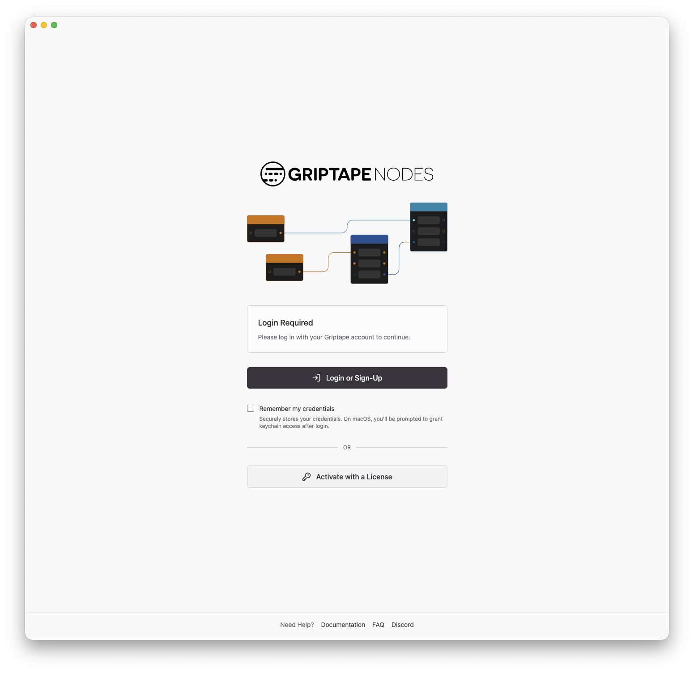
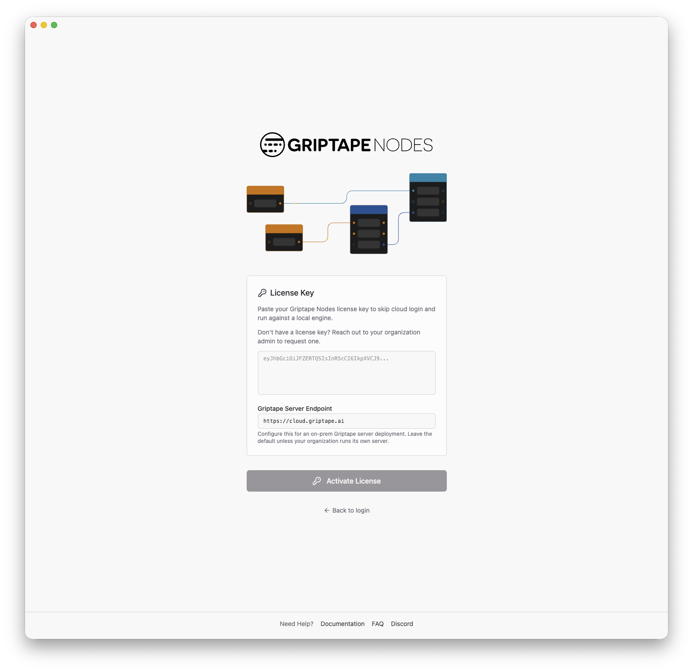
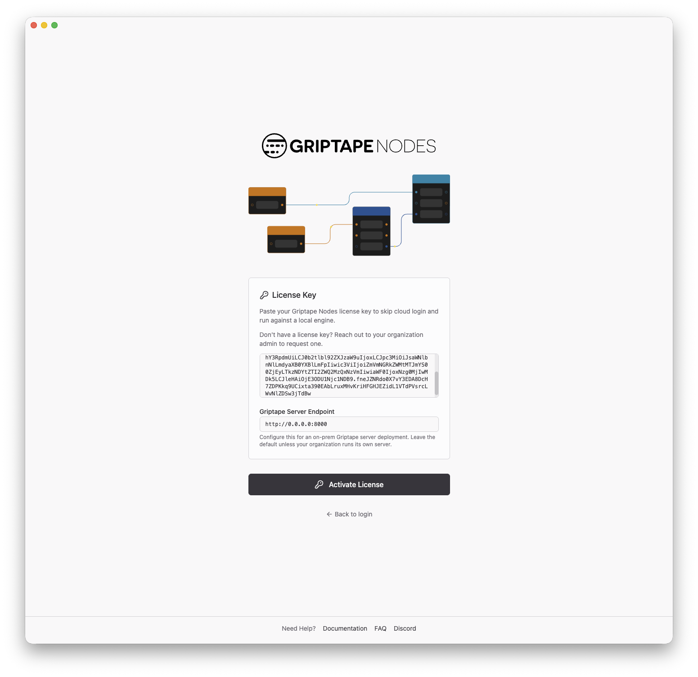

# Admin Server 사용하기 {: #using-the-admin-server }

[Admin Server](admin_server.md)가 설정되어 실행되면 사용자는 Griptape Cloud에 로그인하는 대신 라이선스로 활성화하여 Griptape Nodes 데스크톱 애플리케이션에서 서버에 연결합니다. 이 페이지에서는 사용자 관점에서 해당 활성화 과정을 단계별로 설명합니다.

## 시작하기 전에 {: #before-you-start }

각 사용자에게 다음 항목이 필요합니다:

- 설치된 **Griptape Nodes 데스크톱 애플리케이션**.
- **라이선스 키(License key)**: 조직에 발급되며 사용자는 조직 관리자에게 요청해야 합니다.
- **Admin Server 주소**: 사내 네트워크에서 Admin Server에 접근할 수 있는 URL(예: `http://admin.internal.example.com:8080`). Admin Server 운영자가 이를 제공합니다.

## 라이선스로 활성화하기 {: #activate-with-a-license }

### 1. 라이선스 양식 열기 {: #1-open-the-license-form }

데스크톱 애플리케이션을 실행합니다. 로그인 화면에서 Griptape Cloud로 로그인하는 대신 **Activate with a License**를 클릭합니다.



### 2. 라이선스 키 붙여넣기 {: #2-paste-your-license-key }

**License Key** 필드에 조직 관리자로부터 받은 라이선스 키를 붙여넣습니다.



### 3. Admin Server 주소 지정하기 {: #3-point-at-the-admin-server }

**Griptape Server Endpoint** 필드에서 기본 Griptape Cloud 주소(`https://cloud.griptape.ai`)를 사내 Admin Server 주소로 변경합니다:

```text
http://admin.internal.example.com:8080
```

이 설정은 애플리케이션의 Griptape Cloud API 요청을 Admin Server로 라우팅합니다. 엔드포인트만으로는 다운로드와 미리 보기가 라우팅되지 않습니다. 데스크톱 HTTPS 라우팅을 활성화하려면 [Admin Server를 통해 HTTPS 트래픽 라우팅하기](#route-https-traffic-through-the-admin-server)를 참조하세요.



### 4. 활성화 완료 {: #4-activate }

**Activate License**를 클릭합니다. 애플리케이션이 라이선스를 검증하고 정상적으로 엔진을 실행하여 에디터 화면으로 이동합니다. 라이선스 관리, 세션, 조직에서 허용한 Cloud API 요청은 구성된 Admin Server 엔드포인트를 사용합니다.

## Admin Server를 통해 HTTPS 트래픽 라우팅하기 (Route HTTPS traffic through the Admin Server) {: #route-https-traffic-through-the-admin-server }

**Route HTTPS traffic through this server**(이 서버를 통해 HTTPS 트래픽 라우팅)를 활성화하면 HTTPS 다운로드와 미리 보기가 Admin Server를 통해 라우팅됩니다. Admin Server 운영자에게 Admin Server 0.4.0 이상을 실행 중이며 [`tunnel.allowed_hosts`](admin_server.md#tunnel)에 필요한 대상이 있는지 확인해 달라고 요청하세요.

엔드포인트와 체크박스는 활성 라이선스가 있을 때만 표시됩니다. 라우팅은 기본적으로 꺼져 있으며, `https://cloud.griptape.ai`가 아닌 Admin Server 엔드포인트가 필요합니다.

1. 오른쪽 상단의 계정 또는 라이선스 메뉴를 열고 **App Settings**(앱 설정)를 선택합니다.
1. **License**에서 **Griptape Server Endpoint**를 확인합니다. 값을 변경했다면 **Save**를 클릭합니다.
1. **Route HTTPS traffic through this server**(이 서버를 통해 HTTPS 트래픽 라우팅)를 활성화합니다.
1. 실행 중인 엔진을 다시 시작합니다.

## 저장된 라이선스 재사용 {: #reusing-a-saved-license }

이전에 활성화한 라이선스는 저장되어 기억됩니다. 로그아웃하거나 라이선스가 비활성화된 경우 **Activate with a License**를 클릭하면 로그인 화면에 **Saved licenses** 섹션이 표시됩니다. 저장된 라이선스 옆의 **Use**를 클릭하면 키를 다시 붙여넣지 않고도 재활성화할 수 있습니다. 구성된 서버 엔드포인트도 기억되므로 Admin Server 주소는 한 번만 입력하면 됩니다.

## 문제 해결 (Troubleshooting) {: #troubleshooting }

- **활성화가 즉시 실패함**: 라이선스 키가 완전히 붙여넣어졌는지, 만료되지 않았는지 확인하세요. 키가 올바르다면 **Griptape Server Endpoint**가 맞는지, 머신에서 해당 서버에 접근할 수 있는지 확인합니다. 브라우저에서 `http://<admin-server-address>/health`를 열어보세요. 정상적인 서버는 `{"status":"ok"}`로 응답합니다.
- **이전에는 활성화되었으나 지금은 실패함**: 라이선스가 만료되었을 수 있습니다. 조직 관리자에게 새 라이선스를 요청하세요.
- **활성화 후 일부 기능에서 오류 반환**: Admin Server가 [전송 규칙(forwarding rules)](admin_server.md#forwarding-rules)으로 구성된 경우 허용되지 않은 경로는 `403 {"error":"path not permitted"}`로 거부됩니다. 해당 기능의 경로가 아웃바운드로 허용되어 있는지 Admin Server 운영자에게 문의하세요.
- **활성화는 성공하지만 다운로드 또는 미리 보기가 실패함**: **Route HTTPS traffic through this server**가 활성화되어 있는지 확인하고 엔진을 다시 시작하세요. 운영자에게 Admin Server 0.4.0 이상 사용 여부와 허용된 터널 대상을 확인해 달라고 요청하세요. 자세한 내용은 [Admin Server를 통해 HTTPS 트래픽 라우팅하기](#route-https-traffic-through-the-admin-server)를 참조하세요.
- **다운로드에서 `tunnel host not permitted` 또는 `tunnel host unreachable` 오류가 표시됨**: 오류 메시지와 표시된 대상 호스트를 운영자에게 전달하세요. 라이선스 문제가 아니라 Admin Server의 차단된 터널 대상이나 연결 실패를 나타냅니다. 자세한 내용은 [Admin Server 문제 해결 섹션](admin_server.md#troubleshooting)을 참조하세요.
- **모든 요청에서 오류 반환**: 모든 요청이 실패하면 Admin Server 자체가 Griptape Cloud에 접근하지 못하고 있을 수 있습니다. 이는 운영자 측의 문제이므로 [Admin Server 문제 해결 섹션](admin_server.md#troubleshooting)을 참조하세요.
