# ConceptImgGeneration_R2V_Workflow
최근 업데이트되는 생성형 비디오 모델들은 R2V, 즉 Reference To Video 기능을 지원합니다. 그래서 기존 파이프라인에서 만든 애니메이션의 동작이나 카메라 등을 레퍼런스로 삼아, 원하는 구도에 최대한 가까운 비디오를 생성할 수 있습니다.
지금까지 알아본 Griptape의 기본 생성 구조를 활용해, 하나의 프롬프트로 캐릭터 컨셉 이미지를 만들고 기존 방식의 FBX 애니메이션을 간단히 Playblast로 뽑은 영상을 이용해 R2V 비디오를 생성해 봅니다.

1.  자연어를 입력할 Text Input 노드를 만듭니다.

2.  Master Shot용 Agent 노드를 만들고, Text Input을 Prompt에, 3D 애니메이션 스타일의 룰셋용 프롬프트를 RULESETS에 연결합니다.

3.  FLUX.2 Image Generation 노드를 만들고, Master Shot용 Agent의 output을 Prompt에 연결합니다.
    Model은 FLUX.2 \[Klein\] 4B, 해상도는 896 × 1152로 설정합니다. (설정은 자유롭게 선택해도 되며, 이번 실습에서 사용한 세팅입니다.)

4.  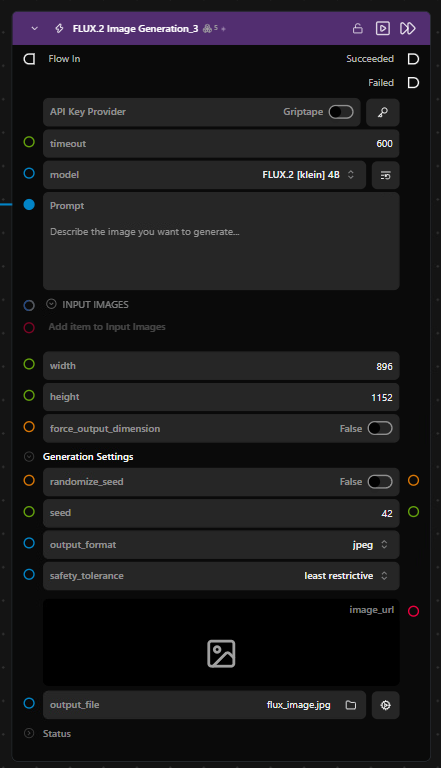

5.  FLUX.2 Image Generation 노드를 2개 더 복사해 Side View와 Back View용 노드를 만듭니다.

6.  Side View에는 Search Replace Text 노드를 꺼내, 이전 Agent 노드 프롬프트의 front view를 side view로 텍스트만 바꾼 후 FLUX 노드의 prompt에 연결합니다.

7.  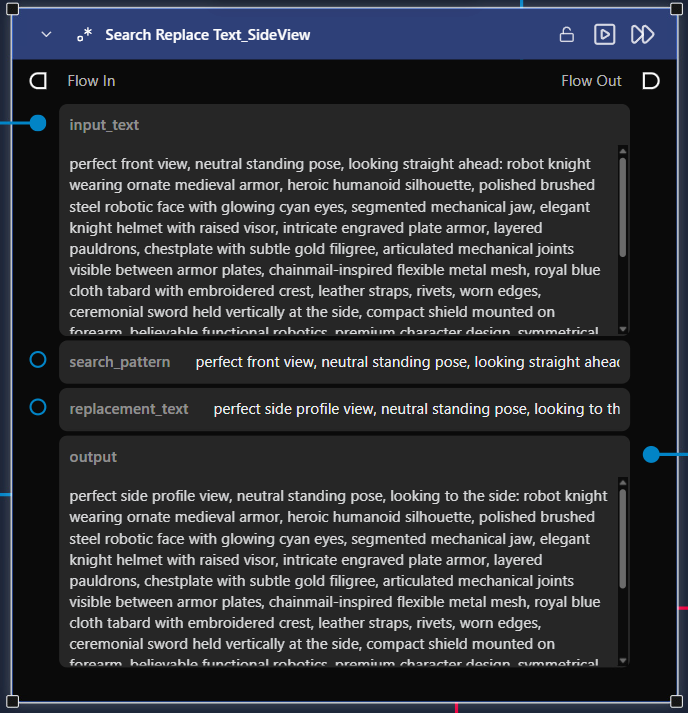

8.  Back View에는 Agent를 활용해 캐릭터 뒷모습에 대한 묘사를 더 추가합니다.

9.  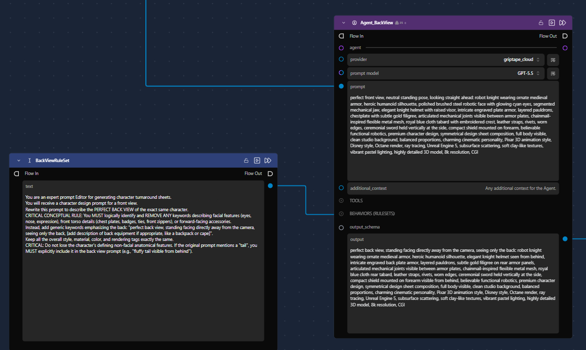

10. Merge Images 노드를 꺼내 Master Shot, Side View, Back View에 해당하는 FLUX 노드의 output을 각각 연결합니다.

11. 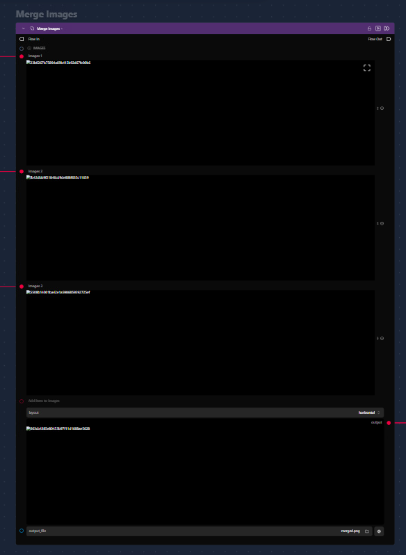

12. Side View와 Back View는 현재 연결 방식으로는 일관성이 떨어져 보일 수 있습니다. 일관성을 더 맞출 수 있는 다른 모델(예: 레퍼런스 이미지를 입력받는 모델)을 사용하거나, 적합한 프롬프트를 만들어내도록 룰셋을 조정하면 좋습니다.

13. Seedance Generation 노드를 만들고, Merge Images 노드의 output을 이미지 레퍼런스 입력에 연결합니다.

14. 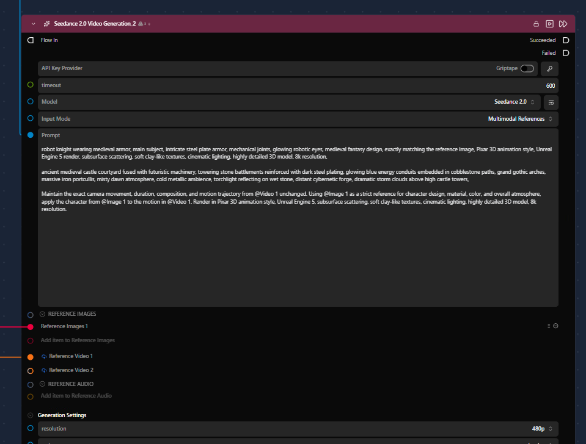

15. 미리 뽑아둔 애니메이션 Playblast 영상을 Griptape로 불러온 후 Reference Video 입력에 연결합니다.

16. 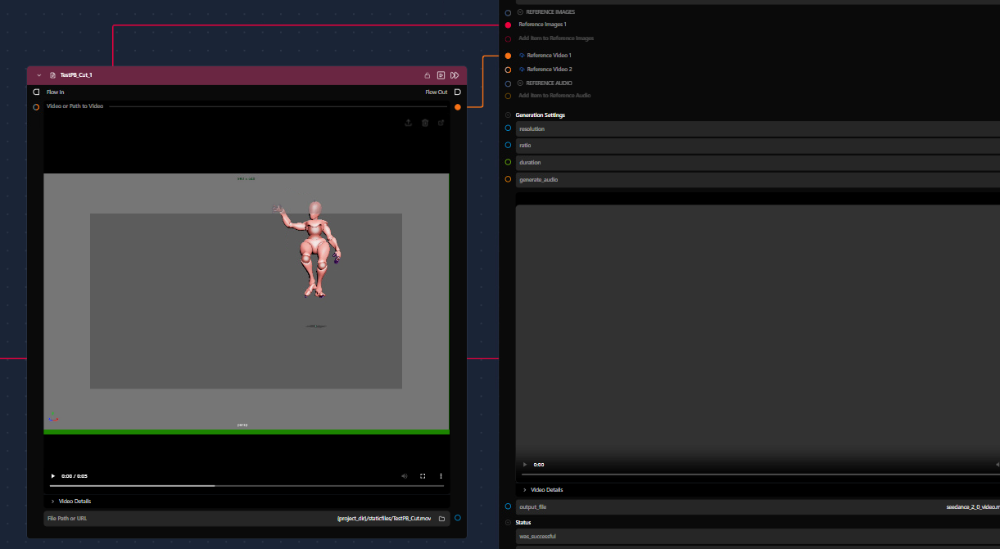

17. Seedance가 이미지와 비디오 레퍼런스를 잘 따르도록, 프롬프트를 만들어주는 Agent들을 생성해 캐릭터와 배경을 묘사합니다. 처음 입력한 Text Input까지 연결선이 너무 길어질 경우 Dot 노드를 만들어 경유시킨 후 각 Agent의 Prompt에 연결합니다.

18. 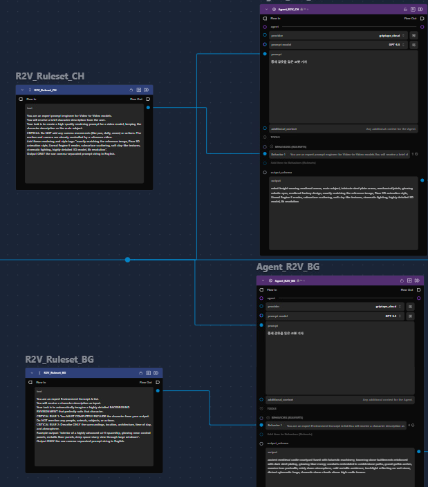

19. 각 묘사 프롬프트 결과와 레퍼런스 애니메이션을 강화하는 프롬프트를 Merge Texts로 합친 후 Seedance Generation의 prompt에 연결합니다.

20. 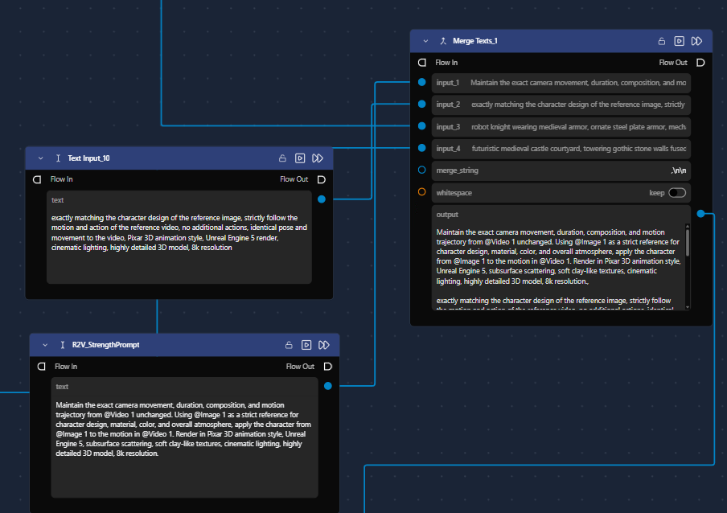

21. 비디오를 생성합니다.

22. 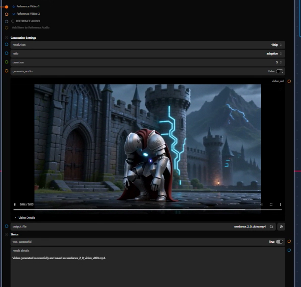

23. 현재 준비한 Playblast에는 배경이나 바닥 등이 표시되어 있지 않아 카메라나 동작이 조금 다르게 생성될 수 있습니다.

24. Web Scraper 툴을 이용해 현재 워크플로우에 라이팅 등의 프롬프트를 추가할 수 있습니다.

25. 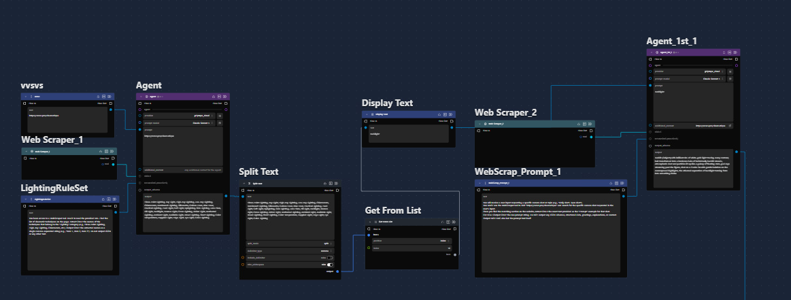

4.  생성형 AI는 실행할 때마다 결과가 랜덤하게 나오므로, 여러 번 반복 실행한 후 마음에 드는 결과를 고르는 방식이 효과적입니다. 토큰 사용량이 많아도 괜찮다면 Cloud 기반 노드를, 토큰이 부담된다면 Local 모델을 사용하는 노드를 활용해 반복 생성하는 것을 추천합니다.
Loop, ForEach 노드의 활용

1.  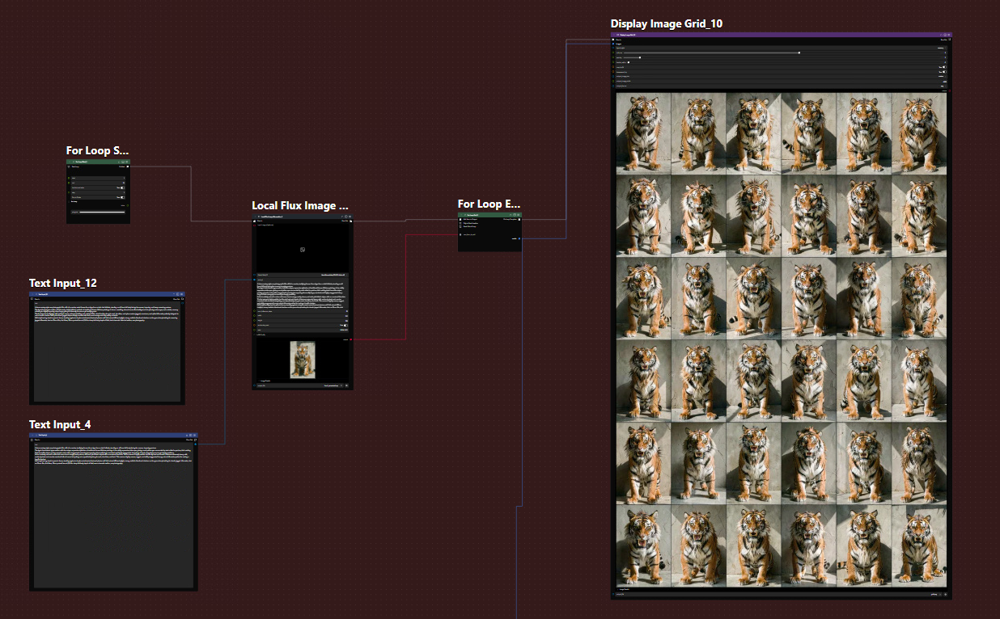
