# Griptape 설치 및 기본설정

## Pre-requisites {: #pre-requisites }

#### **워크샵 용 크레딧은 워크샵 전 일괄 발급 예정입니다.** 
#### **워크샵 전에는 크레딧을 사용하지 말아주세요!**

### **Griptape Nodes 설치**

Griptape Nodes Desktop은 엔진과 에디터를 모두 포함하는 단일 애플리케이션입니다. 엔진을 자동으로 설치 및 관리하고, 로그인을 처리하며, Griptape API 키를 자동으로 프로비저닝하므로 수동으로 설정할 것이 없습니다.

<!-- -->

1.  다운로드 및 설치

    1.  griptapenodes.com에서 운영체제에 맞는 Griptape Nodes Desktop을 다운로드하세요. macOS, Windows, Linux용으로 제공됩니다.

        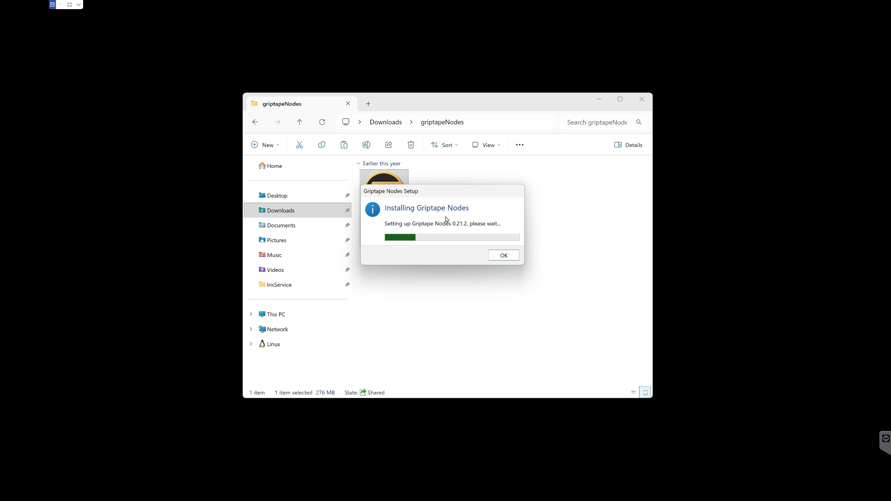

    3.  처음 설치 후 구동 시, 업데이트 있을 시 로그인 전 업데이트 진행하는 것을 추천합니다.

        1.  Download & Restart를 클릭해주세요.

        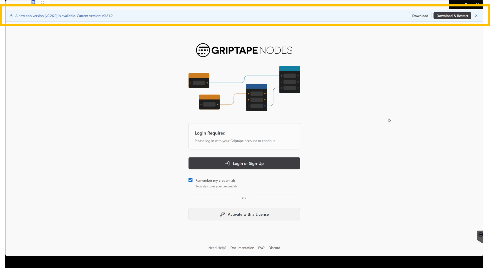

    5.  업데이트 설치가 완료되면 Griptape Nodes 앱이 실행됩니다.

        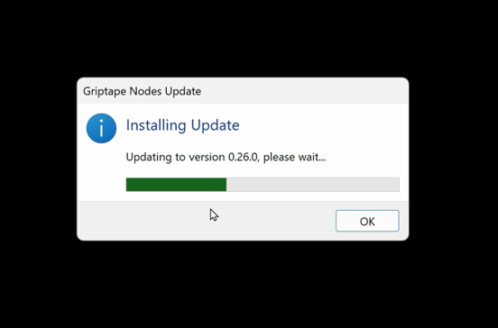

2.  로그인

    1.  애플리케이션을 실행하고 Login or Sign-Up을 클릭하여 Griptape 계정으로 로그인합니다.

    2.  이 때 로그인하는 계정은 Foundry공식 웹사이트(www.foundry.com)와 별개의 계정입니다. 

    3.  갖고 계신 구글 계정으로 로그인 하시는 것도 가능하며 별도의 이메일과 비밀번호로 가입하셔도 됩니다.

        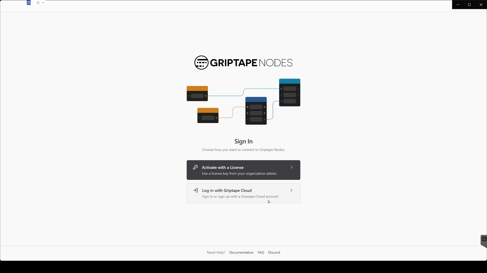

3.  워크스페이스 선택

    1.  처음 실행하면 워크스페이스 디렉토리(workspace directory)를 선택하라는 메시지가 표시됩니다. 워크스페이스 디렉토리는 Griptape Nodes가 프로젝트 파일과 생성된 에셋을 저장하는 위치입니다. 기본값을 그대로 사용하거나 원하는 위치를 선택할 수 있습니다.

        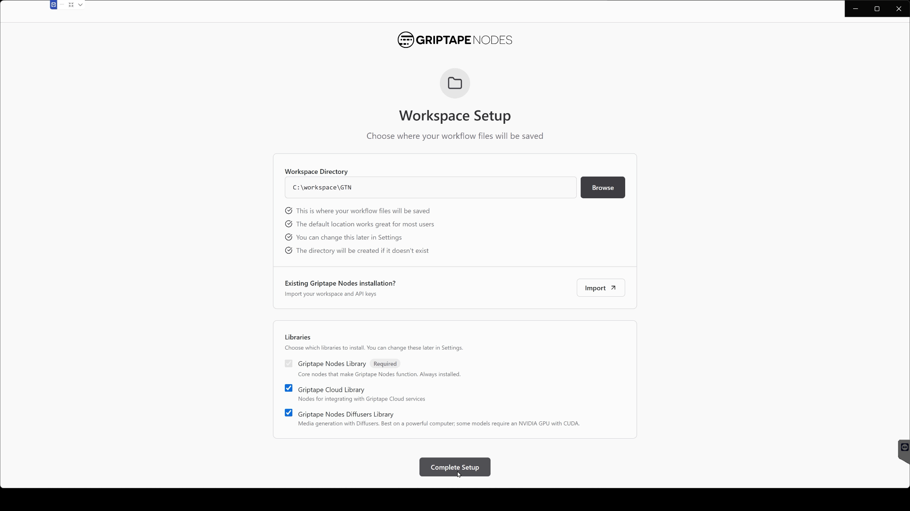

    3.  기본으로 설치되는 라이브러리를 선택합니다.

        1.  Griptape Standard Library

        2.  Griptape Cloud Library(선택)

        3.  Griptape Modular Diffusion Library(선택)

    4.  모든 설정이 완료되었습니다! 애플리케이션이 엔진 설치, API 키 생성, 에디터 실행 등 나머지 작업을 모두 처리합니다.

        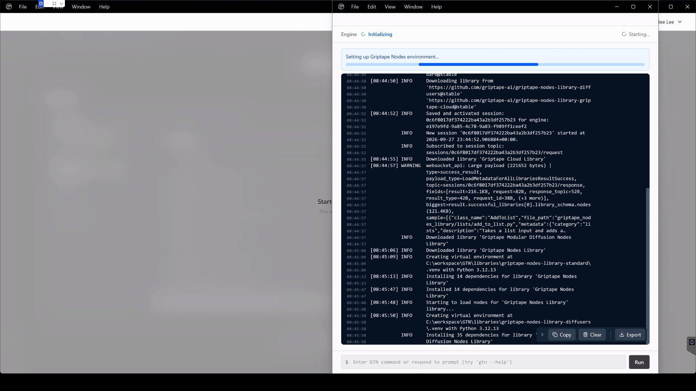

    6.  워크스페이스 변경, 라이선스 관리, 애플리케이션 업데이트 방식 설정 등은 나중에 앱 설정에서 언제든지 조정할 수 있습니다.

4.  템플릿 프로젝트 열어보기

    1.  좌측 하단에서 설치된 라이브러리를 클릭합니다.

        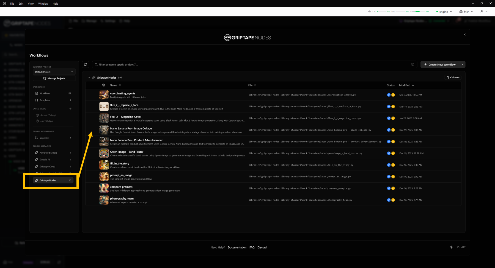

    3.  라이브러리별로 Griptape에서 제공하는 템플릿 프로젝트 목록이 표시됩니다.

    4.  원하는 템플릿을 선택해 열어보고, 노드의 연결 구조와 파라미터 설정을 확인할 수 있습니다.

        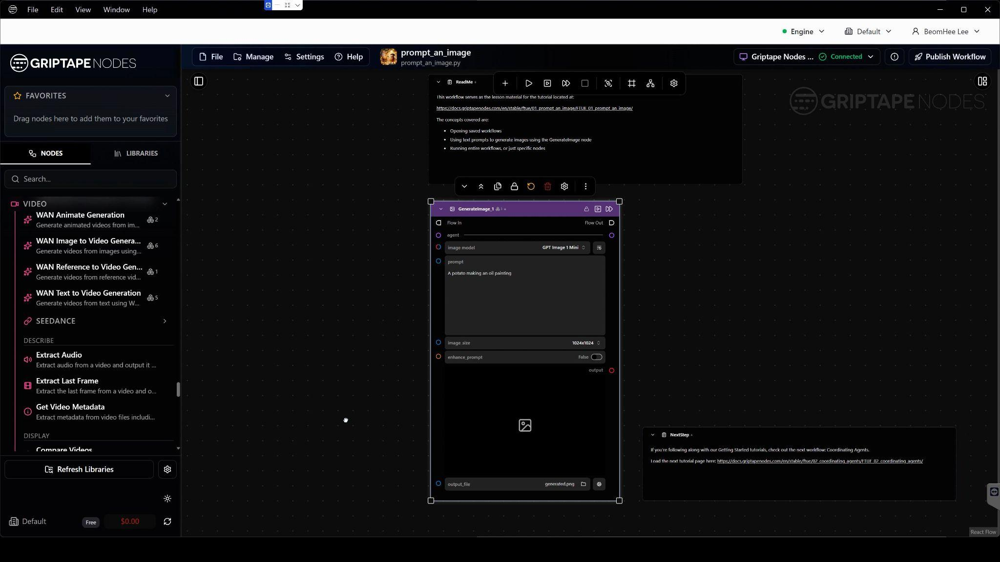

### **(Optional)오픈소스 모델 설치하기Install Open source models**

로컬 환경에서 구동되는 오픈소스 모델을 사용하려면 Hugging Face의 모델 접근 권한과 토큰 설정이 필요합니다.

<!-- -->

1.  Hugging Face Access Token 발급하기

    1.  Griptape Nodes 상단 메뉴에서 Manage - Model Management를 클릭합니다.

    2.  모델 다운로드 및 관리를 위해 Hugging Face 토큰이 필요하다는 안내 문구가 표시됩니다.

        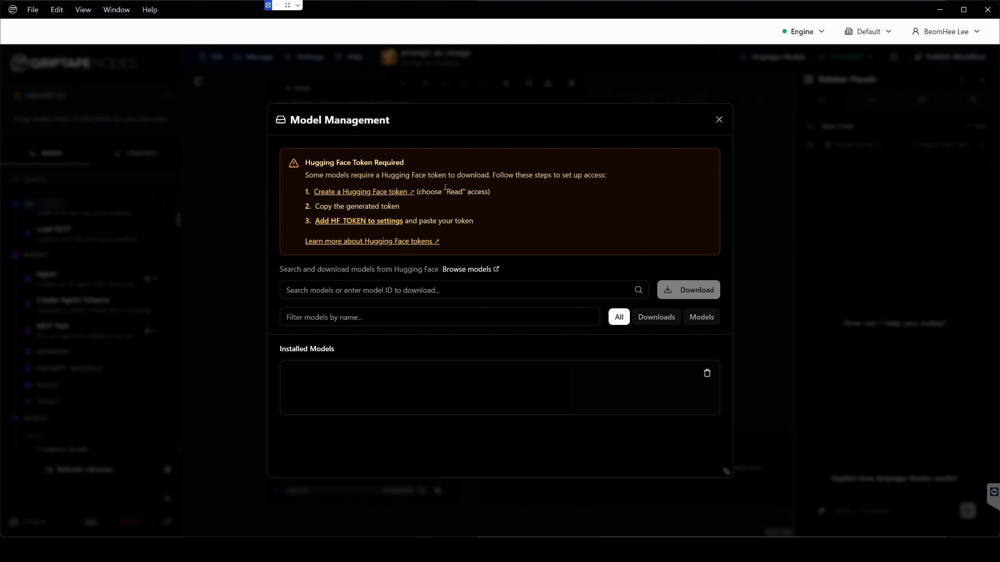

    3.  Create a Hugging Face token 버튼을 클릭하여 Hugging Face 웹사이트의 토큰 발급 페이지로 이동합니다.(Hugging Face 계정이 없는 경우 회원가입 및 로그인을 먼저 진행 해주세요.)

    4.  Hugging Face 토큰 관리 페이지에서 Create new token 버튼을 클릭합니다.

    5.  Token type을 기본 읽기 권한인 Read로, Token name은 gtn으로 입력합니다.(토큰 이름은 자유롭게 지정할 수 있습니다.)

        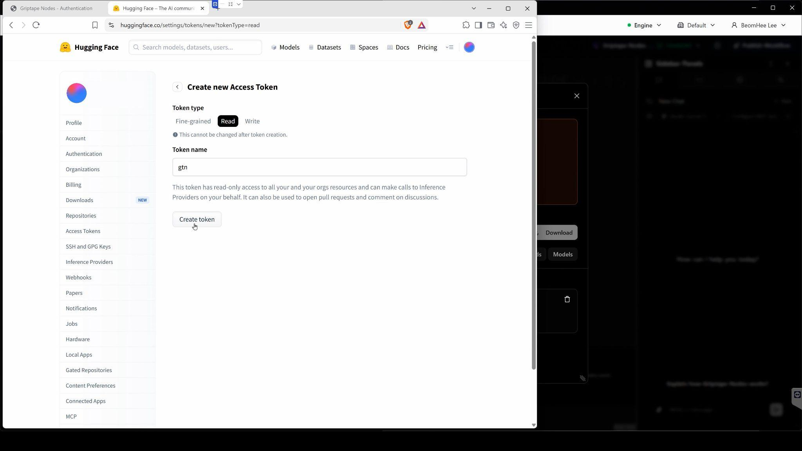

    6.  생성이 완료되면 화면에 Access Token 키값이 표시됩니다. Copy 버튼을 눌러 토큰 값을 복사한 뒤 Done을 클릭합니다.

        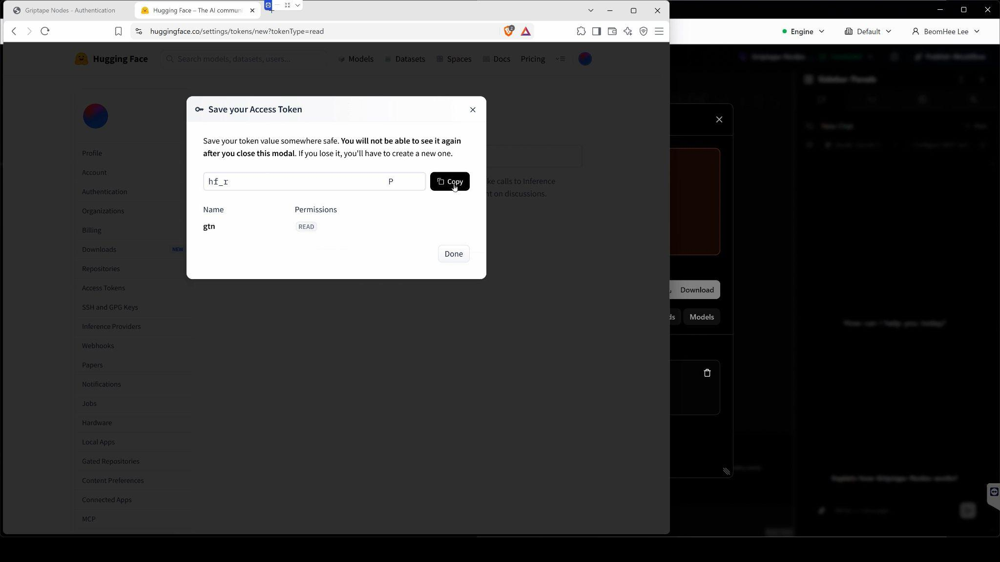

2.  Griptape에 HF_Token 등록하기

    1.  다시 Griptpae Nodes의 Model Management 창으로 돌아옵니다.

    2.  창에 표시된 Add HF TOKEN to settings 를 클릭합니다.

    3.  Configuration Editor 창이 열리며, 설정 내 API Keys & Secrets 탭으로 자동 이동합니다.

        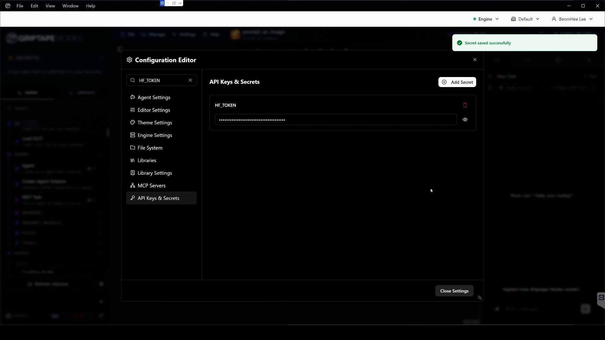

    4.  HF_TOKEN 항목의 입력란에 앞서 복사해 둔 Access Token 키값을 붙여넣습니다.

    5.  입력이 완료되면 우측 하단의 Close Settings 버튼을 클릭하여 설정을 저장하고 창을 닫습니다.

3. 허깅페이스 설정 관련 공식 가이드 문서[https://docs.griptapenodes.com/en/stable/guides/integrations/hugging_face/](https://docs.griptapenodes.com/en/stable/guides/integrations/hugging_face/)

4.  허깅페이스 캐쉬폴더 설정

<!-- -->

**오픈소스 모델(Diffusion, SAM 등)은 용량이 매우 크기 때문에, 기본 C 드라이브 용량이 부족할 경우 용량이 넉넉한 다른 드라이브로 다운로드 캐시 경로를 변경하는 것을 권장합니다.**
**Hugging Face는 환경 변수를 통해 캐시 저장 위치를 지정할 수 있습니다.\**

    1.  용량이 넉넉한 드라이브에 새 폴더를 생성합니다

    2.  환경 변수 설정법 ([https://support.foundry.com/hc/en-us/articles/205764002-Q100015-How-to-set-environment-variables](https://support.foundry.com/hc/en-us/articles/205764002-Q100015-How-to-set-environment-variables))

    3.  사용자 변수 또는 시스템 변수에서 (변수 이름:HF_HUB_CACHE, 변수 값:새로 만든 캐시 폴더 경로) 값을 입력한 후 저장합니다.

    4.  이미 다운로드받은 모델 파일이 있다면, 해당 폴더 안의 파일들을 새로 지정한 폴더로 그대로 복사/이동해 주시면 모델을 다시 다운로드받지 않고 바로 사용할 수 있습니다.
    

5.  SAM3.1 모델 다운로드

    1.  Griptape Nodes 상단 메뉴에서 Manage - Model Management를 클릭합니다.

    2.  모델 검색창에 **sam3**를 입력합니다.

    3.  검색 결과 목록에서 **facebook/sam3.1** 모델을 찾아 선택하고 다운로드를 진행합니다.

        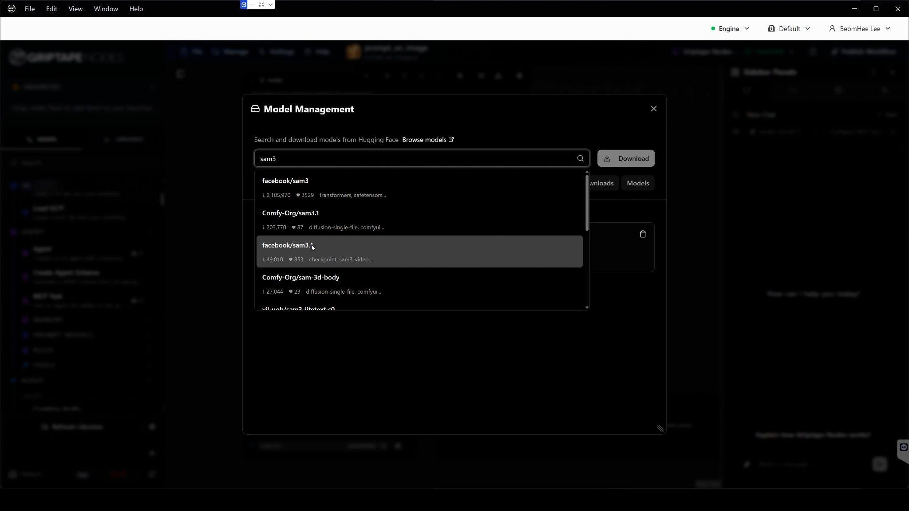

    5.  처음 시도 시 다운로드가 실패했다는 메시지가 표시됩니다. (Meta/Facebook의 정책상 Hugging Face 페이지에서 모델 라이선스 및 접근 권한 승인 절차가 필요하기 때문입니다.)

    6.  메시지의 facebook/sam3.1 공식 모델 페이지로 이동합니다.

        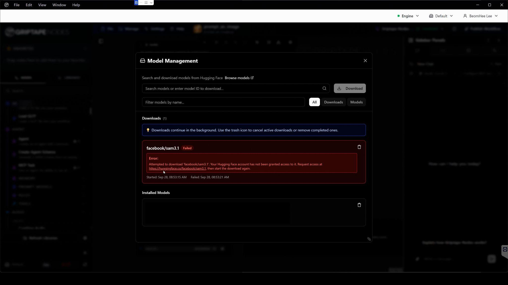

    8.  모델 접근 권한 요청 안내 화면에서 약관 확인 및 사용자 정보를 입력한 후 접근 요청을 완료합니다.

    9.  다시 Griptape Nodes의 Model Management 창에서 facebook/sam3.1 모델의 다운로드를 시도하면 정상적으로 다운로드가 진행됩니다.

        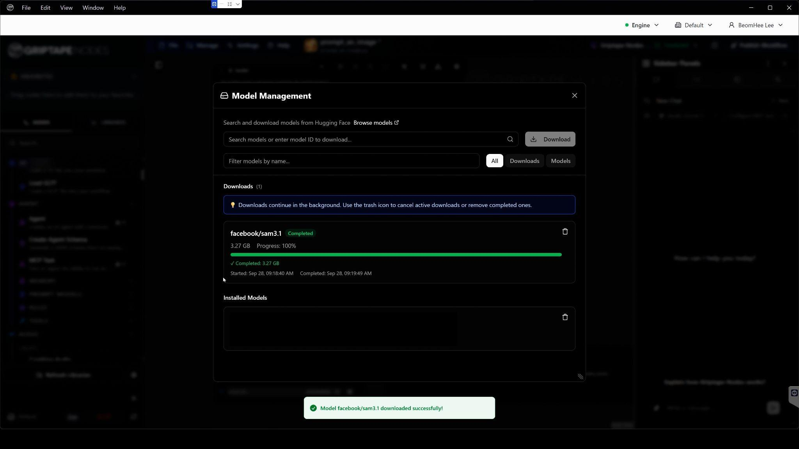

    11. 다운로드가 완료되면 Griptape Nodes 좌측 Nodes 패널 검색 창에 **sam3** 를 검색합니다.

    12. 검색된 SAM3 Segment Image 노드를 워크플로우 캔버스로 드래그하여 배치합니다.

    13. 노드 속성의 model 드롭다운 항목을 확인합니다.

        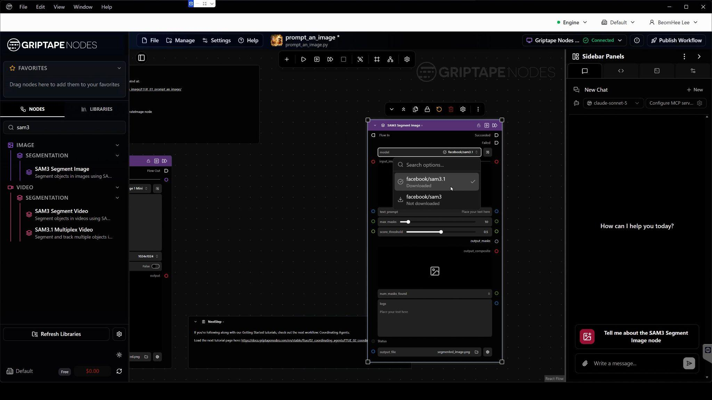

        1.  방금 다운로드 받은 3.1 모델은 바로 선택하여 사용할 수 있습니다.

        2.  아직 다운로드 되지 않은 sam3 모델은 Not downloaded로 표시됩니다.

        3.  미설치 모델을 클릭하면 나타나는 open model manager to download버튼을 눌러, 필요한 다른 모델도 간편하게 추가 다운로드 할 수 있습니다.

### **(Optional)Install Nuke**

1.  Foundry 공식 홈페이지([Foundry.com](http://foundry.com))에 접속합니다.

2.  우측 상단의 Log in을 클릭하여 Foundry 사용자 계정으로 로그인합니다.

    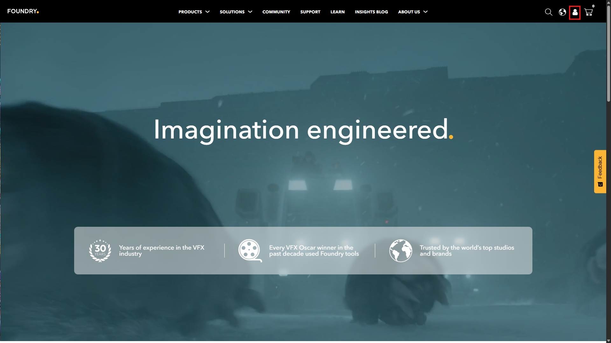

    1.  Foundry 계정은 앞서 생성한 Griptape 로그인 계정과 별개의 계정입니다.

3.  Foundry 제품 다운로드 페이지로 이동합니다.

    1.  [Download Nuke \| Foundry](https://downloads.foundry.com/nuke)

4.  Nuke 최신 버전을 다운로드합니다.

    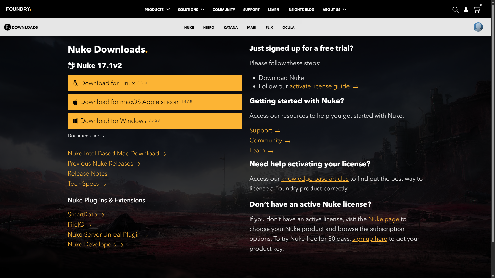

    1.  웹사이트 로그인이 완료되어 있어야 다운로드 링크가 정상 활성화됩니다.

    2.  운영체제(Windows, macOS, Linux)에 맞는 Nuke 최신 버전의 인스톨러를 다운로드합니다.

5.  Nuke 설치하기

    1.  [https://learn.foundry.com/ko/nuke/content/install.html](https://learn.foundry.com/ko/nuke/content/install.html)

    2.  다운로드가 완료된 설치 파일(예: .exe 또는 .dmg)을 실행합니다.

    3.  설치 마법사의 안내에 따라 라이선스 동의 및 설치 경로를 확인하고 설치를 완료합니다.

    4.  설치가 끝나면 Nuke를 실행하여 보유하고 계신 라이선스(상용 라이선스, 평가판 Trial, 또는 Non-Commercial 라이선스 등)로 인증을 완료합니다.
