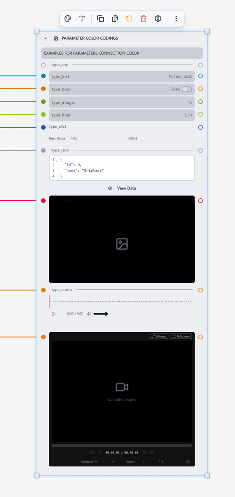

# GTN 101: 기본 워크플로우 소개 {: #gtn-101-basic-workflows }
## 1. GUI 및 설정 둘러보기 (Explore GUI / Settings) {: #explore-gui-settings }

   1. 왼쪽 오른쪽 패널, 세팅  
      1. 왼쪽 - 노드/라이브러리, 조직 관리 및 크레딧 현황  
      2. 우측 - 챗, 커맨드 히스토리, 로그, 파라미터  
      3. 세팅 - Add API Key(Secrets)

   2. 엔진, 로그   
   3.   
   4. Load Image/Video - do something - Save Image/Video  
      1. 노드 생성방법  
         1. 드래그  
         2. Tab 서치  
   5. 파라미터 설명  
      1. 
## 2. 라이브러리 설치 (Install libraries) {: #install-libraries }

   1. Automatic and manual  
   2. 자동 설치  
   3. 수동 설치
## 3. 에이전트와 대화하기 (Talk with Agent) {: #talk-with-agent }

   1. Using Agent  
      1. https://docs.griptapenodes.com/en/stable/nodes/agents/create_agent/  
   2. Chain multiple agent nodes  
   3. Let agent generate prompt  
   4. Ruleset, Additional context  
   5. Chat with agent in the sidebar  
      1. 궁금한 것 물어보기  
      2. 워크플로우 생성해달라고 하기  
      3. (Optional)MCP로 Claude Code 연결하기
## 4. 이미지/비디오 생성 및 스케치 (Generate Image / Video / Draw) {: #generate-image-video-draw }

   1. Generate Image  
      1. Google Nano Banana / Seedream

   2. Generate Video  
      1. Seedance 2.5 / Kling 

   3. Draw/Sketch  
      1. ImageBash노드로 간단한 합성 및 스케치 해보기  
      2. Paint Mask

   4. Put references in multiple ways  
   5. Display Image / Video  
   6. Compare 노드  
   7. Text 노드
## 5. 모델별 정보 (Model Information) {: #model-information }

   1. 이미지모델별 레퍼런스 이미지, 사이즈, 아웃풋

      

| Node | Models (default bold) | Ref images (max) | Size / aspect control | Images per run | Seed | Negative prompt | Prompt help | Output format | Safety / other |
| :---- | :---- | ----- | :---- | ----- | :---- | :---- | :---- | :---- | :---- |
| **OpenAI Image Gen** | gpt-image-1(서비스종료예정 2026-10-23), 1.5, 2, 2.5-sunburst, 2.5-flare | 16 | 1/1.5: 1024², 1024×1536, 1536×1024. 2.x: 8 presets up to 3840×2160, plus custom W×H (multiples of 16px, ≤3840 edge, ≤3:1, 0.66–8.3MP) | n 1–10 | ✗ | ✗ | ✗ | png/jpeg/webp, compression 0–100 | moderation auto/low, quality low/med/high, background auto/opaque/transparent (transparent only on gpt-image-1) |
| **Google (Nano Banana)** | gemini-3-pro-image, gemini-3.1-flash-image | 14 (auto-shrinks files over 7MB) | aspect: 10 ratios on Pro, 14 on Flash (adds 1:4, 1:8, 4:1, 8:1). image_size 1K/2K/4K, Flash adds 512 | whatever the model returns (all_images list), plus a text output | ✗ | ✗ | ✗ | ✗ | temperature 0–2, top_p 0–1, Google Search grounding, Google Image Search (Flash only) |
| **Seedream** | 5.0 Pro, 5.0 Lite, 4.5 | 10 on Pro (each image after the first is billed), 14 on Lite/4.5 | presets or exact W×H. Pro: 1K/1.5K/2K. Lite: 2K/3K/4K, up to 6240×2656. 4.5: 2K/4K | max_images 1–15 on Lite/4.5. Pro: 1 | ✗ | ✗ | optimize_prompt standard/fast (5.0 only; fast on Pro only) | jpeg/png (5.0 only) | watermark always off |
| **Flux 2** | flux-2-pro, flex, max, klein-4b, klein-9b | 8 | width/height 16–8192 in steps of 16, total ≤4MP | 1 | ✓ (+ randomize) | ✗ | ✗ | jpeg/png | safety preset ×3, steps 1–50 and guidance 1.5–10 (flex only), force_output_dimension |
| **Flux Kontext** | flux-kontext-pro | 1 (optional) | 9 aspect ratios, about 1MP | 1 | ✓ | ✗ | prompt_upsampling | jpeg/png | safety preset ×3 |
| **Qwen Image Edit** | qwen-image-edit, edit-plus, edit-plus-2025-10-30 | 1 on base model, 6 on Plus models (at least 1 required; 384–3072px, ≤10MB each) | none (follows the input) | one per input image | ✓ | ✓ | ✗ | ✗ | watermark |
| **Qwen Image Gen** | qwen-image, qwen-image-plus | 0 | 5 fixed sizes (1328², 1664×928, etc.) | 1 | ✓ | ✗ | prompt_extend | ✗ | watermark |
| **Wan Image** | wan2.7-image-pro, wan2.7-image | 0 | 1K/2K/4K (4K on Pro only) | n 1–4 | ✓ (optional) | ✗ | thinking_mode | ✗ | watermark |
| **Grok Image Edit** | grok-imagine-image | 1 (required) | resolution 1k/2k (tooltip says only 1k works) | n 1–10 | ✗ | ✗ | ✗ | ✗ | quality (tooltip says it currently does nothing) |
| **Grok Image Gen** | grok-imagine-image | 0 | 14 aspect ratios plus auto, resolution 1k/2k | n 1–10 | ✗ | ✗ | ✗ | ✗ | quality (tooltip says it currently does nothing) |
| **Generate Image (agent)** | gpt-image-1-mini, gpt-image-1.5 | 0 | 1024², 1536×1024, 1024×1536 | 1 | ✗ | ✗ | enhance_prompt | ✗ | accepts an agent input |

      

   2. 레퍼런스 이미지 연결 후 이미지들을 프롬프트에서 불러오는 방법  
      노드의 이미지 목록에 배치된 순서대로 "Image 1", "Image 2" ... 와 같이 위치를 기준으로 지칭하세요.   
      6개 노드 모두 이미지를 전송할 때 이 순서를 유지합니다  
      - Flux 2, Google, GPT Image, Seedream이 이에 해당합니다.   
      어떤 노드도 이미지에 직접 이름을 지정할 수 없으므로, 모델이 인식할 수 있는 유일한 식별 수단은 해당 이미지의 위치(순서)뿐입니다.

**프롬프트 패턴:**

* Image 1: 캐릭터 (얼굴 및 헤어스타일)  
* Image 2: 재킷  
* Image 3: 부츠  
* Image 4: 배경 장면  
* Image 5: 색상 팔레트 / 라이팅 참조  
* Image 1 캐릭터의 전신샷을 생성해 주세요. Image 2의 재킷과 Image 3의 부츠를 착용하고 있으며, Image 4의 배경 장면에 서 있는 모습이어야 합니다. 라이팅과 색감은 Image 5와 일치시켜 주세요. Image 1의 얼굴은 변경 없이 그대로 유지해 주세요.

**팁 (Tips):**

* 이미지 번호와 함께 해당 이미지에 무엇이 있는지 설명해 주세요 (예: "Image 2, 빨간색 재킷"). 모델이 순서를 놓치더라도 설명을 통해 해당 요소를 맞출 수 있습니다. 이는 이미지가 3~4장을 넘어갈 때 특히 중요합니다.  
* 각 이미지마다 단 하나의 역할만 부여하세요. 레퍼런스 이미지를 원하는 부분만 나오도록 크롭하여, 모델이 재킷 사진의 배경까지 함께 반영하지 않도록 하세요.  
* 유지할 요소와 변경할 요소를 명확히 지시하세요 ("Image 1의 얼굴 유지", "Image 5에서는 텍스처만 사용" 등).  
* 해당 저장소(repo)의 자체 템플릿도 이 방식을 사용합니다. Flux 2의 "얼굴 교체(replace a face)" 템플릿 프롬프트는 다음과 같습니다: "Image 2의 마스크를 사용하여 Image 1에 Image 3의 인물을 인페인팅(Inpaint)하세요."  
* Google (Nano Banana): 해당 노드는 프롬프트를 먼저 보낸 후 모든 이미지를 전송합니다. 각 이미지 옆에 라벨을 직접 붙일 수 없으므로, 프롬프트에 작성한 번호별 설명이 그 역할을 대신합니다.  
* 목록의 순서를 바꾸면 몇 번째 이미지인지(Image N)도 달라집니다. 입력을 다시 연결했다면 프롬프트도 함께 업데이트하세요.  
* 모델이 계속 레퍼런스를 혼동한다면, 각 요소들을 라벨이 붙은 하나의 콜라주 이미지로 합성하여 사용하는 것도 방법입니다. 

  

  3. 비디오 생성 노드(텍스트 / 이미지 / 레퍼런스 -> 비디오) 

| Node | Models (default first) | Image inputs | Other ref inputs | Duration | Resolution / aspect | Other settings |
| :---- | :---- | :---- | :---- | :---- | :---- | :---- |
| Seedance 2.5 | seedance-2-5 (fixed) | first + last frame, or up to 30 ref images | up to 10 videos, up to 10 audio | auto or 4–30s | 480p/720p/1080p; 7 ratios + adaptive | task (T2V / frames / ref / edit / extend), audio, mp4/mov, watermark, return last frame |
| Seedance 2.0 | 2.0, 2.0 Fast, 2.0 Mini | first + last frame, or up to 9 ref images | up to 3 videos, up to 3 audio | auto or 4–15s | 480p–4K (Fast/Mini max 720p); 7 ratios | mode (text / frames / multimodal), audio |
| Seedance 1.x | 1.5 Pro, 1.0 Pro, 1.0 Pro Fast | first + last frame (no last frame on Fast) | none | 4–12s | 480p/720p/1080p; 7 ratios | camera fixed, audio (1.5 Pro only) |
| Veo 3.1 | 3.1, 3.1 Fast | start + last frame, up to 3 ref images ("asset") or 1 ("style"); refs not on Fast | none | 4/6/8s (refs force 8s) | 720p/1080p; 16:9, 9:16 | neg prompt, seed, audio, person generation, 1–4 samples |
| Kling Omni | v3-omni, o1 | first + end frame + ref images, max 7 total (4 with a ref video; end frame only if ≤2 images) | 1 ref video (edit or feature), element IDs | 3–15s (v3), 3–10s (o1) | std/pro/4K; 16:9, 9:16, 1:1 | multi-shot (≤6 shots), keep video sound |
| Kling I2V | v3, v2.6, v2.5 turbo, v2.1 master, v2.1, v2 master, v1.6, v1.5, v1 | start + end frame (end frame needs pro, not on master models) | static/dynamic masks | 3–15s (v3), else 5/10s | std/pro (4K on v3); no aspect param | neg prompt, cfg, multi-shot (v3), sound (v2.6 pro) |
| Kling T2V | v3, v2.6, v2.5 turbo, v2.1 master, v2 master, v1.6 | none | none | 3–15s (v3), else 5/10s | std/pro (4K on v3); 16:9, 9:16, 1:1 | neg prompt, cfg, multi-shot (v3), sound (v2.6 pro) |
| Wan R2V | wan2.6-r2v | none | up to 3 ref videos (subject + voice), 1 audio | 5/10s | 10 sizes at 720p/1080p (16:9, 9:16, 1:1, 4:3, 3:4) | neg prompt, seed, single/multi shot, audio, watermark |
| Wan I2V | 2.6, 2.5, 2.2 flash, 2.2 plus, 2.1 plus, 2.1 turbo | 1 first frame (required) | 1 audio (2.5/2.6) | 5/10/15s on 2.6, 5/10 on 2.5, mostly 5s on others | 480p–1080p, varies by model | neg prompt, seed, audio, shot type (2.6), prompt extend, watermark |
| Wan T2V | 2.6, 2.5, 2.2 plus, 2.1 turbo, 2.1 plus | none | 1 audio (2.5/2.6) | 5/10/15s on 2.6, 5/10 on 2.5, 5s on others | 480p–1080p, varies by model | same as Wan I2V |
| LTX I2V | 2.5 Fast, 2.5 Pro, 2.3 Fast/Pro, 2 Fast/Pro | first + last frame | none | 6–20s (even numbers; >10s only at 24/25fps on Fast) | 720p–4K, portrait on 2.5; 24/25/48/50 fps | camera motion, audio |
| LTX T2V | same 6 models | none | none | same as LTX I2V | same as LTX I2V | camera motion, audio |
| LTX A2V | 2.5 Fast, 2.5 Pro, 2.3 Pro, 2 Pro | 1 optional image | 1 audio (required) | no setting (likely follows the audio) | 1920x1080 or 1080x1920 | guidance scale |
| Gemini Omni Flash | gemini-omni-flash-preview | ref images, no cap in code | none | model picks (3–10s) | 720p; 16:9, 9:16 | none |
| Hailuo | 2.3, 02, 2.3 Fast | first frame (required on Fast), last frame (02 only) | none | 6/10s | 720p/768p/1080p (10s = 768p only) | prompt optimizer, fast pretreatment |
| Grok | grok-imagine-video | 1 first frame | none | 1–15s | 480p/720p; 7 ratios | none |
| OmniHuman | 1.5, 1.0 | 1 subject image (required) + subject masks | 1 audio (required) | follows the audio | none | seed, fast mode |
| Sora (deprecated) | sora-2, sora-2-pro | 1 start frame | none | 4/8/12s | 720p sizes (+1792 sizes on pro) | none; has buttons to migrate to Veo or Seedance |

     1. Edit, extend, transfer 노드

| Node | Inputs | Settings |
| :---- | :---- | :---- |
| Kling Motion Control | 1 character image + 1 motion video | std/pro, character orientation (image/video), keep sound |
| Kling Extension | an earlier Kling video ID (not a file) | prompt, neg prompt, cfg |
| Wan Animate (mix/move) | 1 image + 1 motion video, no prompt | std/pro; length follows the video |
| Grok Video Edit | 1 mp4 (≤8.7s) + prompt | none |
| LTX Retake (2.3 Pro) | 1 video (≤21s) + prompt | segment start/end (≥2s), replace audio+video / video / audio |
| LTX Extend (2.3 Pro, 2 Pro) | 1 video + optional prompt | extend from start/end, 2–20s added, 0–20s context |
| LTX HDR (2.3 Pro) | 1 SDR video, no prompt | none; outputs a ZIP of EXR frames |

**요약 :**

* **최대 레퍼런스 이미지 갯수**: Seedance 2.5(30개)가 가장 많으며, 그 다음으로 Seedance 2.0(9개), Kling Omni(7개) 순입니다. Gemini Omni Flash는 코드상 제한을 두지 않습니다.  
    
* **비디오 레퍼런스 갯수**: Seedance 2.5(10개), Seedance 2.0 및 Wan R2V(3개), Kling Omni(1개) 순입니다.  
    
* **최장 클립 길이**: Seedance 2.5(30초), LTX(20초), 그 다음으로 Seedance 2.0, Kling v3, Wan 2.6(각 15초) 순입니다.  
    
* **네거티브 프롬프트(Negative prompt) 지원**: Kling T2V/I2V, Wan, Veo만 지원합니다.  
    
* **시드(Seed) 값 지원**: Wan, Veo, OmniHuman만 지원합니다.

노드의 참조 목록에 있는 입력 위치(순서)와 해당 모델 고유의 태그를 사용하여 각 입력을 지칭합니다. 목록의 첫 번째 항목은 #1입니다 (Gemini의 경우 #0). 모델마다 서로 다른 태그를 사용합니다:

| Node | Tag in prompt | Fits 5 img + 3 vid? |
| :---- | :---- | :---- |
| Seedance 2.5 | @Image 1, @Video 1, @Audio 1 | ✅ (30 img / 10 vid) |
| Seedance 2.0 (Multimodal References mode) | [Image 1], [Video 1], [Audio 1] | ✅ (9 img / 3 vid) |
| Kling Omni | <<<image_1>>>, <<<video_1>>>, <<<element_1>>> | ❌ only 1 video |
| Gemini Omni Flash | <IMAGE_REF_0>, <IMAGE_REF_1> … (starts at 0\) | ❌ images only |
| Wan R2V | character1, character2, character3 | ❌ videos only (3) |

**Seedance 2.5** 모델에 이미지 5장 + 비디오 3개를 레퍼런스로 사용하는 경우:   
@Image 1은 주인공입니다. 그녀는 @Image 2의 재킷을 입고 @Image 3의 거리를 걷습니다.  
@Video 1의 카메라 무빙과 @Video 2의 걷는 동작을 맞춰주세요.  
라이팅과 컬러 그레이딩은 @Video 3처럼 해주세요. @Image 4의 차가 지나가고, @Image 5는 벽에 걸린 간판입니다.

**팁 (Tips):**

* **순서가 전부입니다:** 노드는 연결한 순서대로 목록의 번호를 매기므로, 목록의 순서를 바꾸면 각 태그가 가리키는 대상도 변경됩니다.  
    
* **각 참조에 단 하나의 역할만 부여하세요:** 단순히 이름을 붙이기보다는 역할("캐릭터", "카메라 무빙", "라이팅")을 명확히 지정하세요. 역할이 없는 태그는 서로 뭉개지거나 섞이는 경향이 있습니다.  
    
* **갯수를 개별적으로 관리하세요:** 이미지와 비디오는 각각 별도로 번호가 매겨지므로, @Image 1과 @Video 1은 서로 다른 입력입니다.  
    
* **Seedance 2.5는 오디오 큐(Cue)도 지원합니다:** 음악은 (), 음향 효과는 <>, 대사는 {}를 사용합니다. 편집 및 확장 모드에서는 프롬프트에 "Extend @Video 1 backward(Video 1을 이전으로 확장)"와 같이 수행할 작업을 명시해야 합니다.  
    
* **Kling Omni의 경우:** 참조 이미지가 앞쪽 번호를 차지합니다. 시작 및 끝 프레임은 그 뒤에 오므로 <<<image_N>>> 번호가 밀리지 않도록 유의하세요.
