# Style Change Workflow Example
**Griptape의 핵심 노드인 Agent 노드의 Rulesets 기능을 활용하여 각기 다른 스타일의 프롬프트를 유도하고, 동일한 자연어(한국어)를 입력했을 때 이미지가 어떻게 생성되는지 확인해 봅니다.**

1.  Griptape Nodes를 실행한 후 Create New Workflow 우측의 화살표를 클릭하고 Import Workflow를 선택합니다.

2.  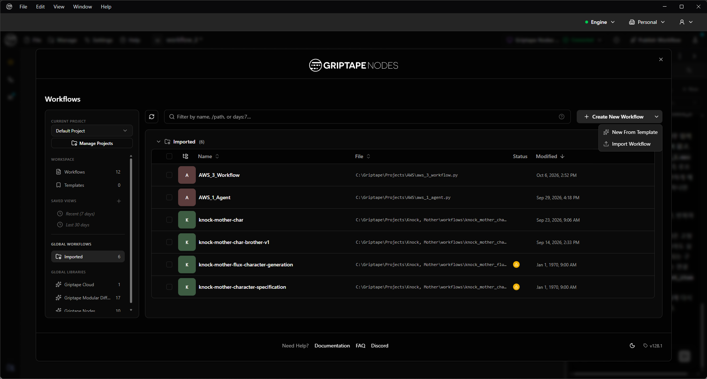

3.  GTN_example_1_agent.py를 임포트합니다. (참고 및 텍스트 복사용으로 사용하며, 실습은 새 캔버스에서 노드를 직접 만들어 보며 진행합니다.)

4.  좌측 Nodes 패널에서 text로 검색하거나, 캔버스에서 Tab을 눌러 text로 검색하면 Text Input 노드를 바로 꺼낼 수 있습니다. (노드 이름 부분을 클릭하면 이름을 바꿀 수 있으며, 용도에 맞게 바꿔두면 노드를 구분하기 편합니다.)

5.  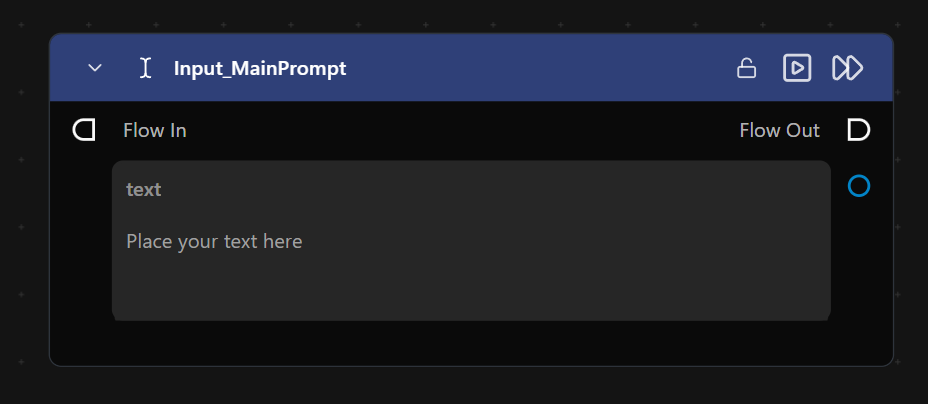

6.  다음으로 Agent 노드를 생성합니다.

7.  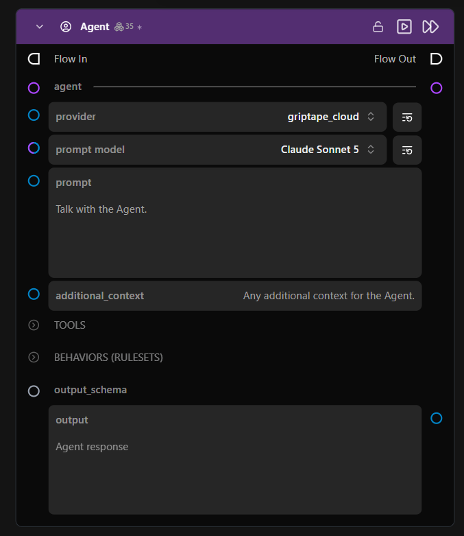

8.  Provider를 griptape_cloud로 설정하면 Griptape 크레딧(토큰)이 차감됩니다. API 키를 등록해 별도의 LLM을 사용하려면 해당 Provider로 변경해 주세요.

9.  Prompt model은 제공되는 모델 중 원하는 것을 선택합니다.

10. Prompt에는 앞서 만든 Text Input 노드를 연결합니다.

11. 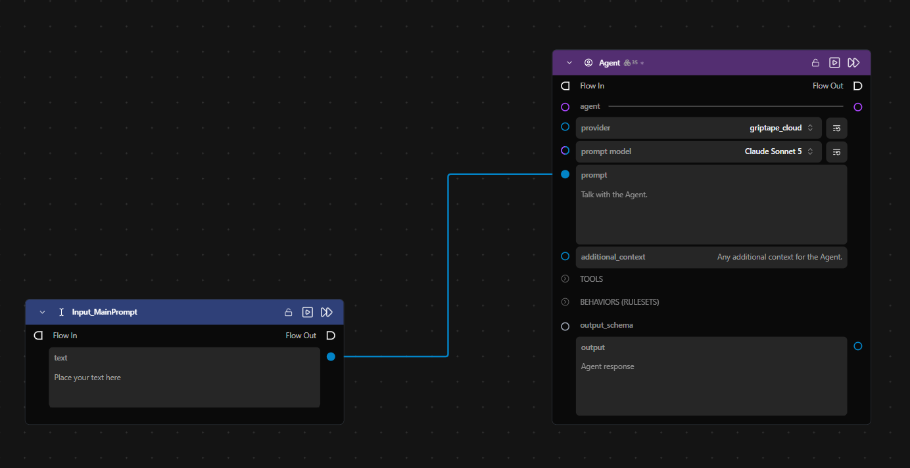

12. VFX Cinematic Movie 스타일에 맞는 룰셋 텍스트를 복사해 Text 노드에 붙여넣은 후, Agent 노드의 BEHAVIORS (RULESETS) 입력에 연결합니다.

13. 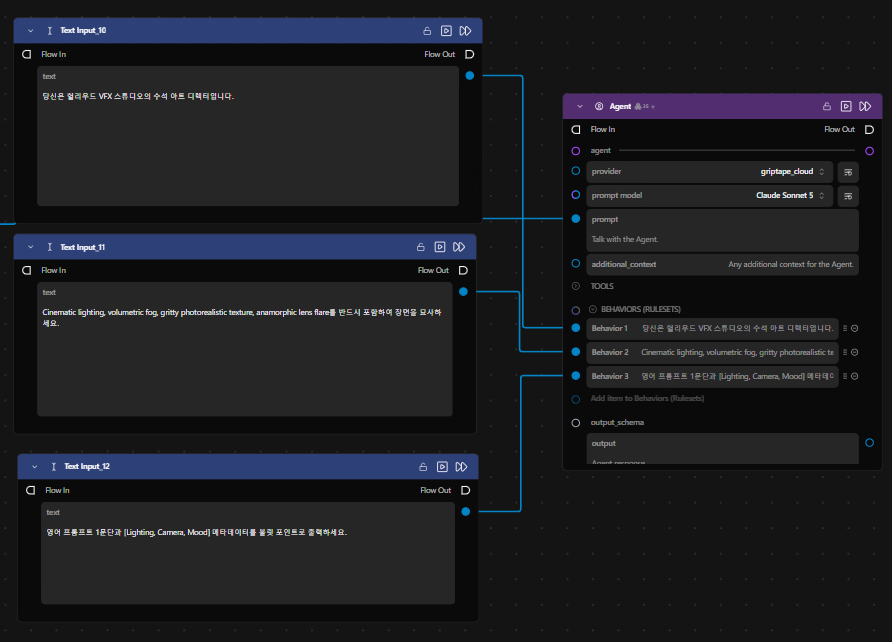

14. Agent가 Output에서 프롬프트 형태를 더 잘 생성할 수 있도록, VFX 스타일과 Animation 스타일 모두에 쓰일 공통 Rulesets를 하나 더 만든 뒤 Merge Texts 노드로 합칩니다.

15. 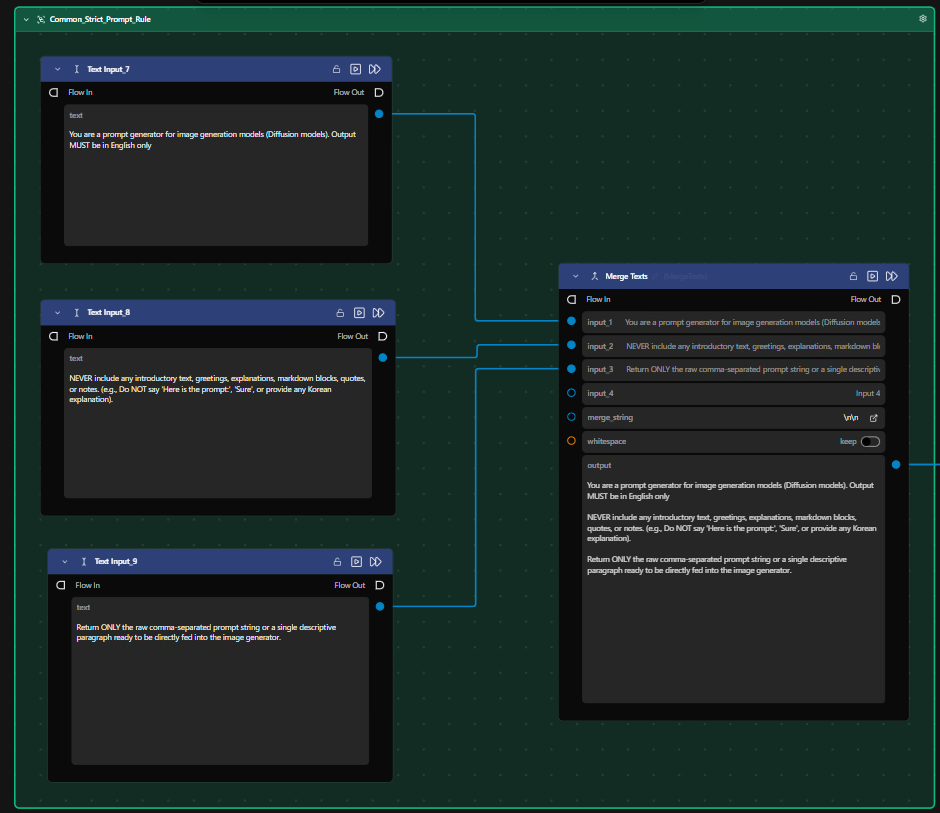

16. Merge Texts로 합친 Rulesets를 Agent 노드에 연결합니다.

17. 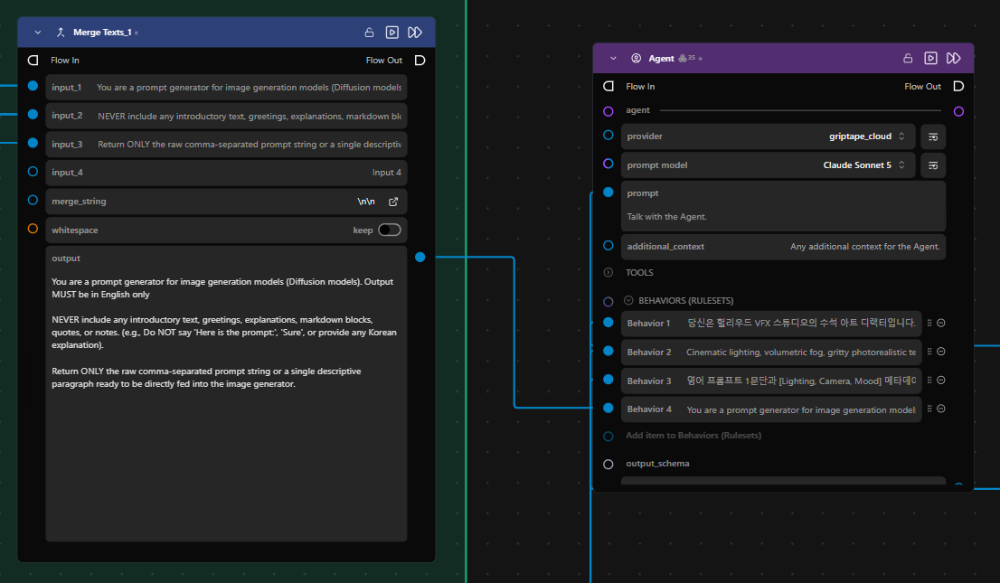

18. 캔버스에서 Tab을 눌러 Google Nano Banana Image Generation 노드를 꺼냅니다.

19. 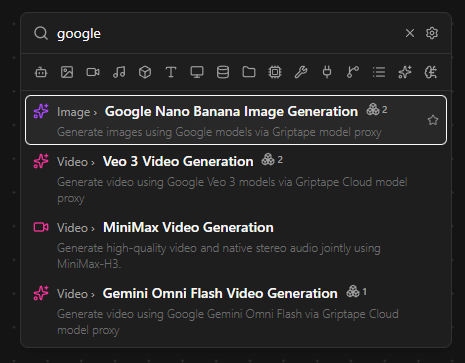

20. Agent의 output을 Google Nano Banana Image Generation 노드의 prompt 입력에 연결합니다.

21. 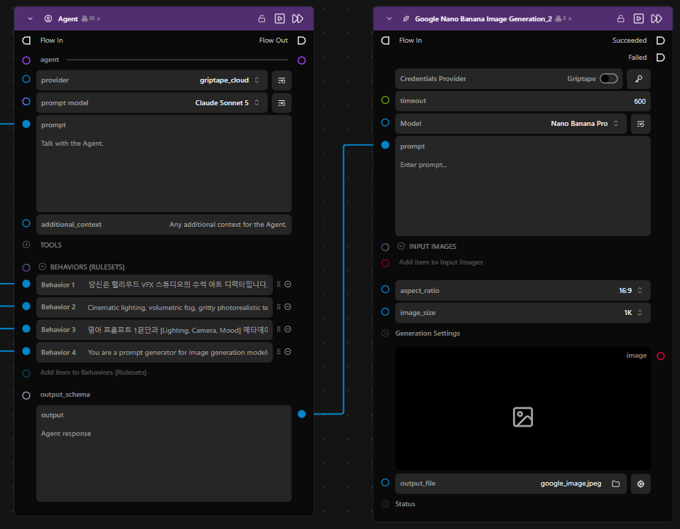

22. 생성된 이미지를 Griptape 안에서 크게 보려면 image 출력을 Display Image 노드에 연결합니다.

23. 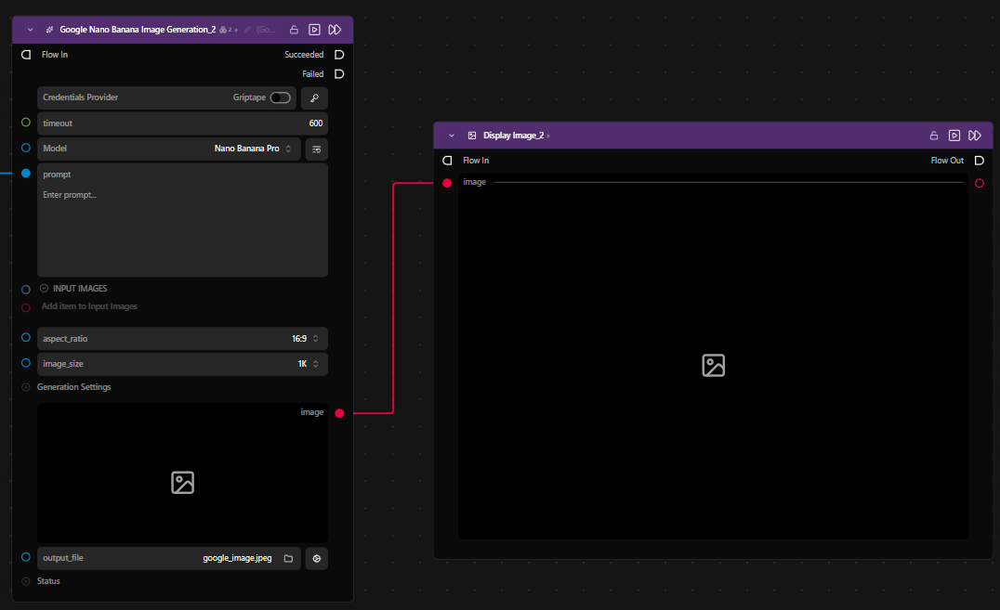

24. 공통으로 쓰는 첫 번째 Text Input과 공통 Rulesets를 제외한 나머지 노드를 Shift + 드래그로 선택한 후 복사(Ctrl+C) 및 붙여넣기(Ctrl+V)합니다.

25. 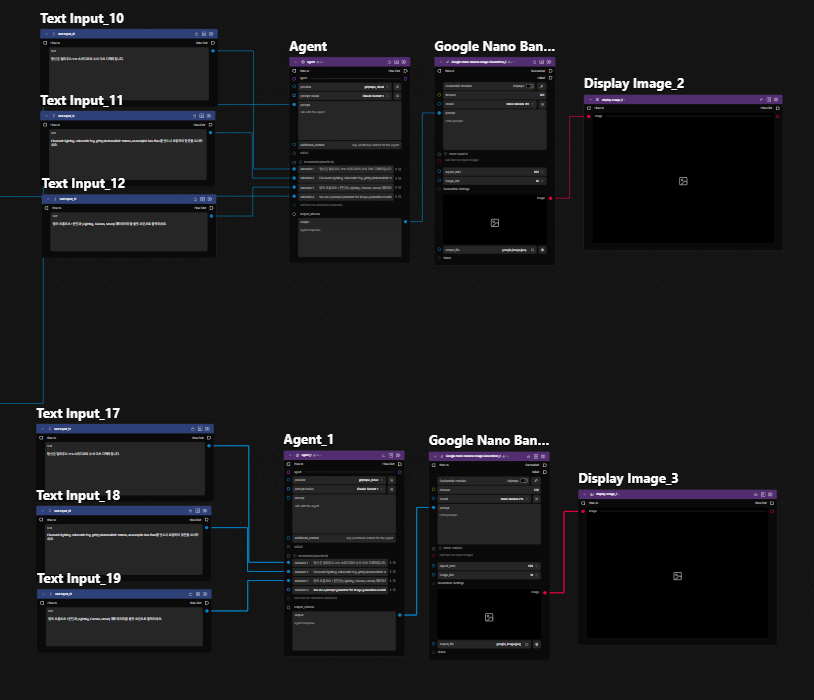

26. 아래쪽에 붙여넣은 스타일 Rulesets 텍스트를 애니메이션 스타일로 바꿉니다.

27. 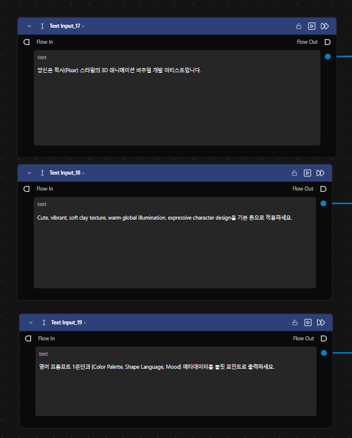

28. 공통 Text Input 노드와 공통 Rulesets 노드를 새로 복사한 Agent에도 연결합니다.

29. 마지막 Image 노드 2개를 Compare Images 노드에 연결합니다. 맨 처음 Text Input에 생성하려는 내용을 입력한 후 Compare Images 노드를 실행합니다.

30. 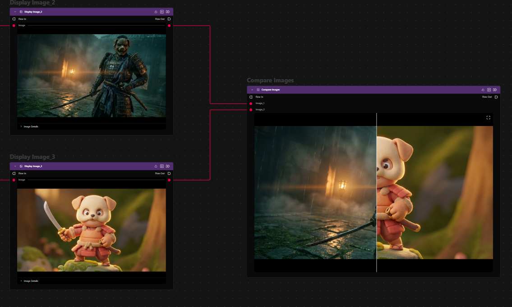

31. 같은 프롬프트로 각기 다른 스타일의 이미지가 한 번에 생성됩니다. Rulesets를 조정하면 원하는 스타일에 가깝게 생성된 컨셉아트 등을 비교해 볼 수 있습니다.
