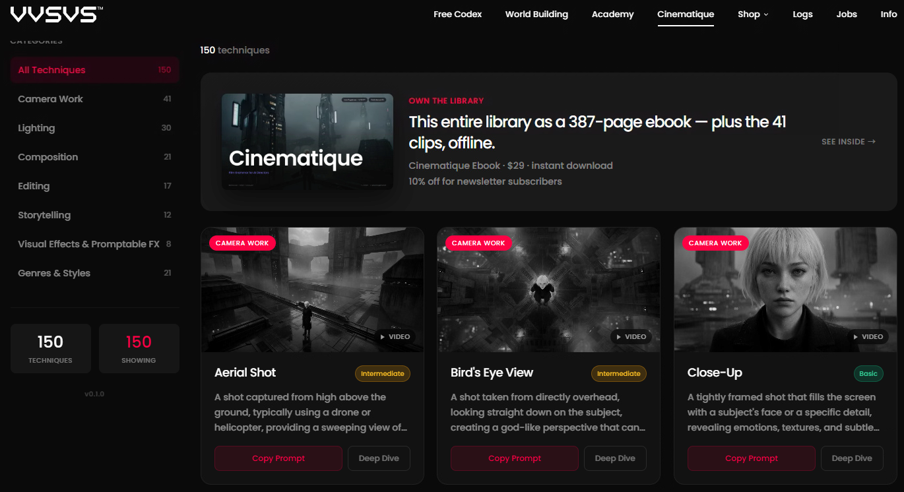
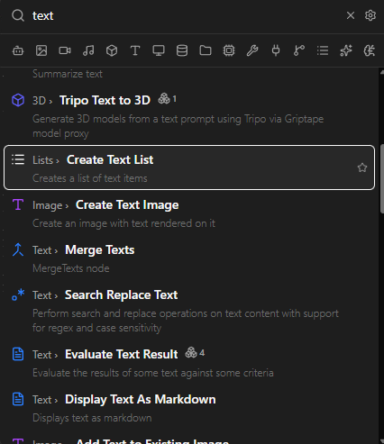
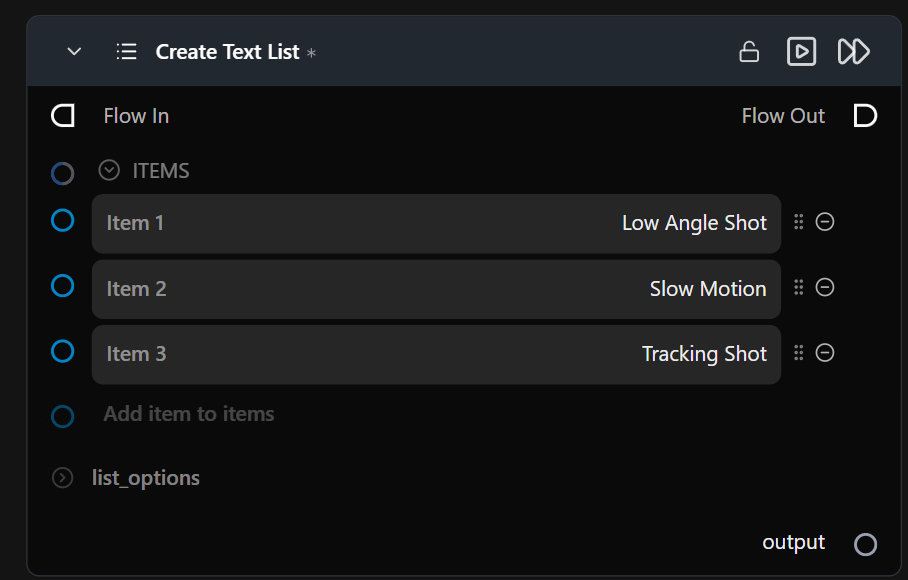
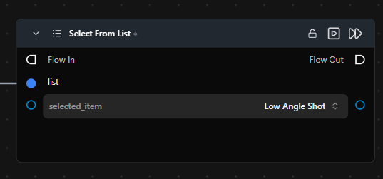
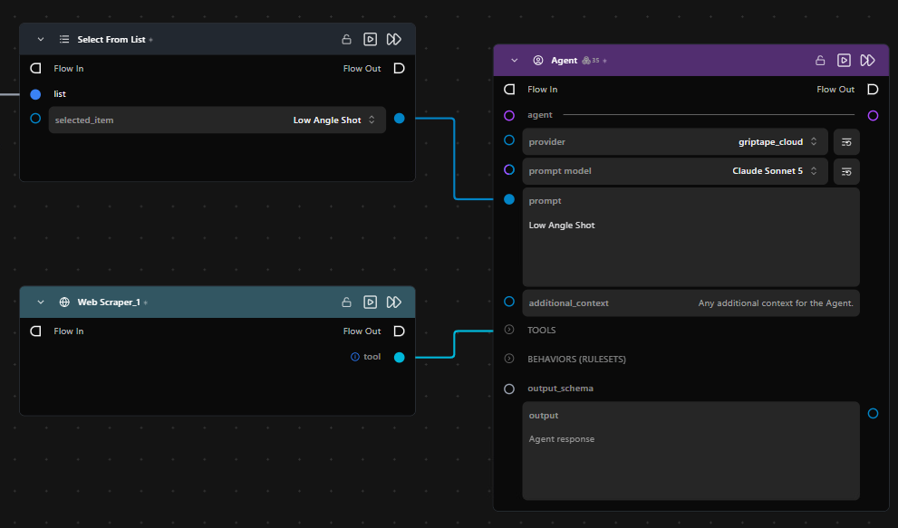
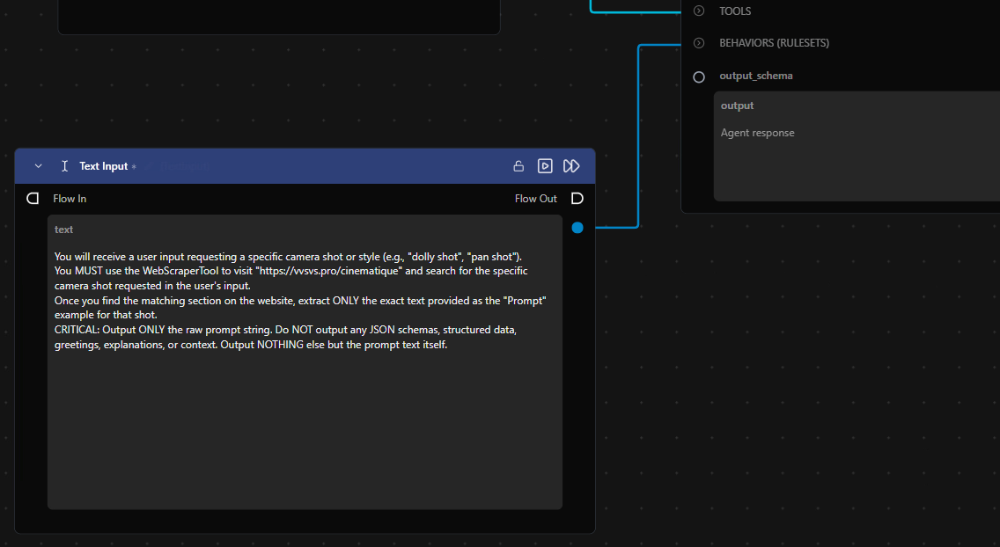
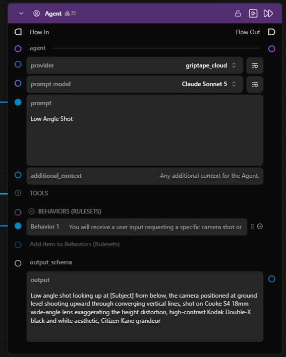
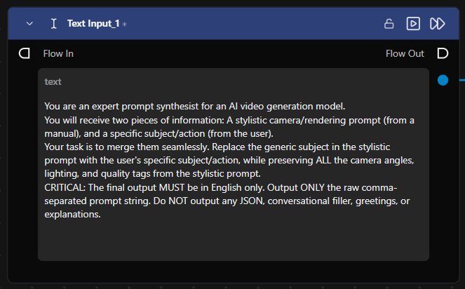
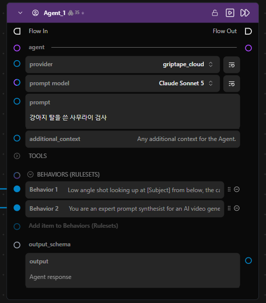
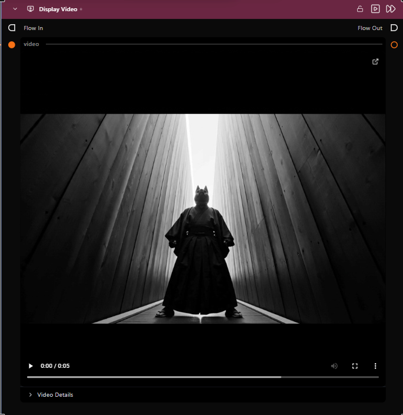

# Agent Tool: Web Scraper 툴을 이용해 외부 프롬프트 가져오기
[https://vvsvs.pro/cinematique](https://vvsvs.pro/cinematique) 의 Cinematic Prompts를 불러오는 예시입니다.

1.  GTN_example_2_webscraper 워크플로우를 임포트합니다.

2.  캔버스에서 Tab을 누르고 text를 입력한 후 Create Text List 노드를 꺼냅니다.

3.  

4.  vvsvs 사이트의 Camera Work 리스트 중 3가지 정도를 골라, Create Text List 노드의 Item으로 추가합니다.

5.  

6.  Select From List 노드를 꺼낸 후 Create Text List 노드의 output을 list 입력에 연결합니다. 그 다음 원하는 아이템을 선택합니다.

7.  

8.  Agent 노드를 만들고 Prompt 입력에 선택한 아이템을 연결합니다.

9.  캔버스에서 Tab을 누른 후 Web Scraper 노드를 검색해 생성합니다.

10. Web Scraper 노드의 tool 출력을 Agent의 TOOLS 입력에 연결합니다.

11. 

12. vvsvs 사이트에서 선택한 아이템의 프롬프트만 가져올 수 있도록 Text 노드를 추가해 Ruleset을 만듭니다. (Agent는 연결된 Tool을 스스로 판단해 사용하므로, Ruleset에 가져올 범위와 출력 형식을 구체적으로 적어주는 것이 좋습니다.)

13. 

14. Agent 노드를 실행해 보고, vvsvs에서 선택한 Low Angle의 프롬프트가 그대로 들어왔는지 확인합니다.

15. 

16. 새로운 Agent 노드를 만들고 이전 Agent의 output을 Rulesets로 연결합니다. 그리고 가져온 vvsvs 카메라 프롬프트의 \[Subject\]를 입력한 프롬프트로 적절히 바꿀 수 있도록 룰셋을 추가합니다.

17. 

18. Prompt에는 생성하고 싶은 Subject를 자유롭게 입력합니다.

19. 

20. Seedance 2.0 Video Generation 노드를 생성하고, 두 번째 Agent의 output을 prompt로 연결합니다. 테스트 중 토큰 소모를 최소화하기 위해 해상도는 480p, Text Only가 체크되어 있는지 확인한 후 생성합니다.

21. 선택한 아이템인 Low Angle Shot에 맞게 영상이 생성됩니다.

22. 
