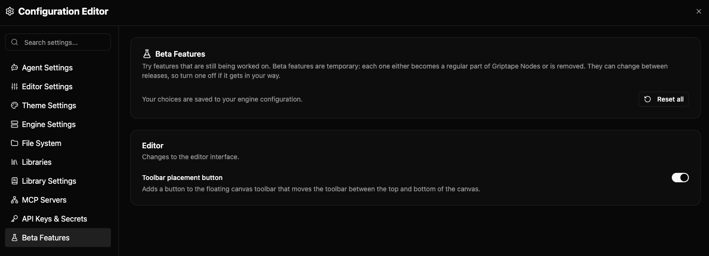

# 베타 기능 (Beta Features) {: #beta-features }

베타 기능은 아직 모든 사용자에게 제공할 준비가 되지 않은 새 기능입니다. 미리 사용해 보려면 켤 수 있으며, 언제든지 다시 끌 수 있습니다. 편집기 설정의 **Beta Features** 페이지에서 관리합니다.



## 베타 기능 켜기 또는 끄기 (Turning a beta feature on or off) {: #turning-a-beta-feature-on-or-off }

편집기 헤더의 **Settings** 메뉴를 열고 **All Settings**를 선택한 다음, 왼쪽 목록 맨 아래의 **Beta Features**를 클릭하세요. 각 기능은 변경 내용과 위치를 설명하는 짧은 설명과 함께 나열되며, 켜거나 끌 수 있는 토글이 있습니다. 선택 내용은 다른 설정과 함께 저장되므로 다음에 편집기를 열어도 그대로 유지됩니다.

기능은 출처에 따라 그룹화됩니다:

- **Editor** 기능은 편집기의 모양이나 동작을 변경합니다.
- **Engine** 기능은 워크플로우 실행 방식처럼 내부에서 일어나는 작업을 변경합니다. 이 기능은 연결된 엔진에서 제공되므로 엔진과 엔진 버전에 따라 목록이 다를 수 있습니다.

노드 라이브러리도 베타 기능을 제공할 수 있습니다. 이러한 기능은 엔진 자체 기능 옆의 **Engine** 그룹에 표시됩니다. 보통 해당 라이브러리의 노드에 기능을 추가하거나 변경하며, 설명에 그 내용이 나와 있습니다. 라이브러리가 로드되면 나타나고, 라이브러리를 제거하면 사라집니다.

모든 항목을 표준 동작으로 되돌리려면 **Reset all**을 클릭하세요. 모든 기능이 기본값으로 돌아가며, 기본값은 거의 항상 꺼짐입니다.

### 모든 베타 기능 한 번에 끄기 (Turning all beta features off at once) {: #turning-all-beta-features-off-at-once }

**Enable beta features** 스위치는 편집기, 엔진 및 라이브러리 기능을 포함한 모든 베타 기능을 한 번에 끕니다. 이 스위치는 **Beta Features** 페이지 상단과, 편집기 헤더의 플라스크 아이콘을 클릭하면 열리는 팝오버에 있습니다.

스위치를 끈다고 선택 내용이 사라지지는 않습니다. 각 기능은 설정한 값을 유지하며, 스위치를 다시 켜면 모두 복원됩니다. 스위치가 꺼져 있는 동안에는 기본적으로 켜져 있는 몇몇 기능을 포함하여 모든 베타 기능이 꺼집니다. 예상과 다르게 동작할 때 각 기능을 하나씩 바꾸지 않고 베타 기능을 원인에서 제외하려면 이 스위치를 사용하세요.

### 캔버스에 이미 있는 노드 (Nodes already on the canvas) {: #nodes-already-on-the-canvas }

노드의 설정을 추가하거나 숨기는 라이브러리 기능은 켜거나 끈 후에 추가한 노드에 변경 내용이 표시됩니다. 캔버스에 이미 있는 노드는 생성 시의 설정을 유지합니다. 노드를 업데이트하려면 노드를 새로 고치거나, 삭제한 후 다시 추가하거나, 워크플로우를 저장한 후 다시 여세요.

### 토글을 변경할 수 없는 경우 (When a toggle can't be changed) {: #when-a-toggle-cant-be-changed }

이 페이지가 아닌 다른 것이 기능 값을 결정하면 해당 토글이 회색으로 비활성화됩니다. 프로젝트, 작업 공간 또는 환경 변수가 값을 설정한 경우에 이런 일이 발생합니다. 토글 아래의 메모에 어떤 항목인지 나옵니다. 그 위치에서 값을 변경하거나 제거하면 이 페이지에서 기능을 다시 제어할 수 있습니다.

## 베타 기능의 예상 동작 (What to expect from a beta feature) {: #what-to-expect-from-a-beta-feature }

- **베타 기능은 변경되거나 사라질 수 있습니다.** 각 기능은 몇 개월 내에 Griptape Nodes의 표준 기능이 되거나 제거됩니다. 그렇게 되면 이 페이지에서 사라지며, 저장된 선택은 아무런 효과가 없습니다.
- **워크플로우는 항상 안전합니다.** 베타 기능은 워크플로우에 저장되는 내용을 변경하지 않습니다. 기능을 켜든 끄든 워크플로우는 동일한 방식으로 열리므로, 서로 다른 기능을 사용하는 사람과 워크플로우를 공유할 수 있습니다.
- **다듬어지지 않은 부분이 있을 것으로 예상됩니다.** 예상과 다르게 동작하면 기능을 꺼서 표준 동작으로 되돌리세요.

## 편집기 없이 베타 기능 설정하기 (Setting beta features without the editor) {: #setting-beta-features-without-the-editor }

선택 내용은 `griptape_nodes_config.json` 파일의 `beta_features` 섹션에 각 기능의 id를 키로 하여 저장됩니다:

```json
{
    "beta_features": {
        "canvas_toolbar_placement_button": true
    }
}
```

라이브러리 기능은 `library_beta_features`에 저장되며, 키는 라이브러리 이름을 소문자로 바꾸고 공백과 구두점을 밑줄로 바꾼 값입니다. "Acme Image Tools" 라이브러리의 경우:

```json
{
    "library_beta_features": {
        "acme_image_tools": {
            "sharpen_after_upscale": true
        }
    }
}
```

`true` 또는 `false`만 인식됩니다. `"yes"`와 같은 다른 값은 엔진 로그에 경고와 함께 무시되며, 기능은 기본값을 사용합니다. 여기서 실수해도 다른 설정에는 영향을 주지 않습니다.

**Enable beta features** 스위치는 `beta_features` 섹션의 `enabled` 키로 저장됩니다. `false`인 경우에만 모든 기능이 꺼집니다. 키가 없거나 다른 값이면 각 기능이 자체 설정을 따릅니다:

```json
{
    "beta_features": {
        "enabled": false
    }
}
```

환경 변수를 사용하여 단일 세션에서만 기능을 켤 수도 있습니다. `GTN_CONFIG_BETA_FEATURES__` 뒤에 기능의 id를 대문자로 붙이세요:

```bash
GTN_CONFIG_BETA_FEATURES__PARALLEL_BRANCH_RESOLUTION=true gtn
```

라이브러리 기능에는 `GTN_CONFIG_LIBRARY_BETA_FEATURES__`를 사용하고, 그 뒤에 라이브러리 키(대문자), 밑줄 두 개, 기능 id를 붙입니다:

```bash
GTN_CONFIG_LIBRARY_BETA_FEATURES__ACME_IMAGE_TOOLS__SHARPEN_AFTER_UPSCALE=true gtn
```

단일 세션에서 모든 베타 기능을 끄려면:

```bash
GTN_CONFIG_BETA_FEATURES__ENABLED=false gtn
```

위 예시의 기능 및 라이브러리 이름은 예시일 뿐입니다. 라이브러리에 베타 기능을 추가하려면 [라이브러리 작성하기](../../development/custom_nodes/authoring_libraries.md)를 참조하세요. 설정 파일과 환경 변수가 로드되는 방식은 [엔진 구성](../configuration.md)을 참조하세요.
